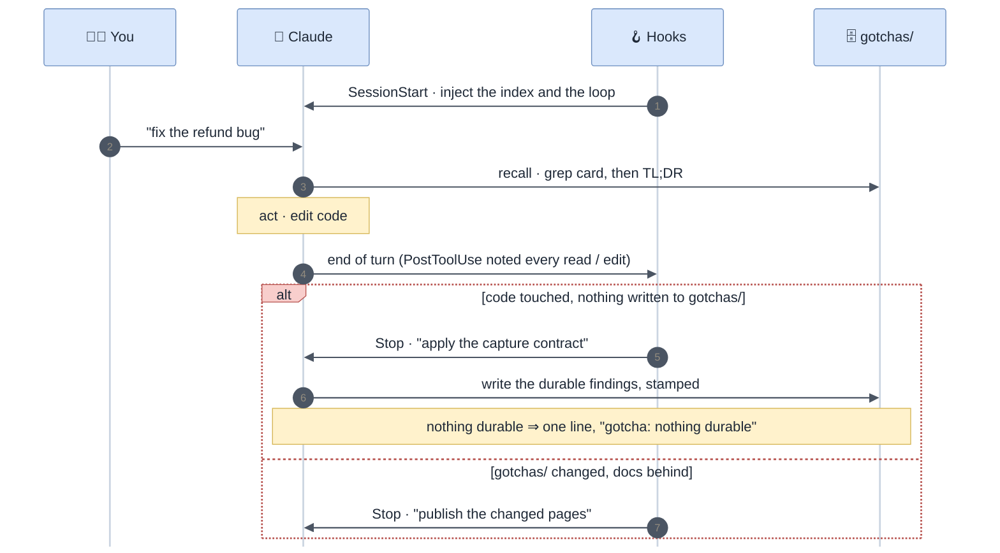
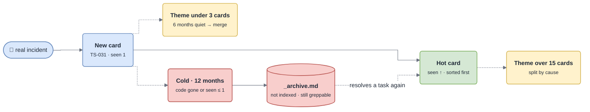
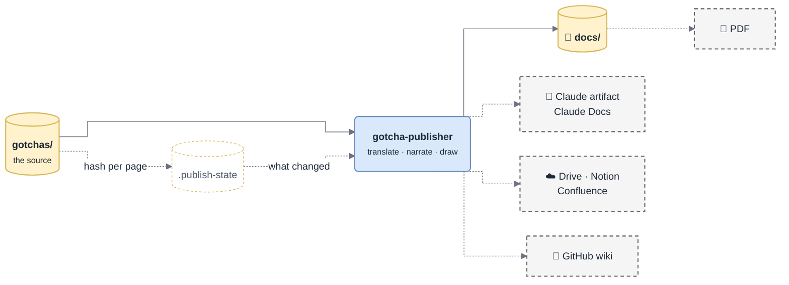

<div align="center">


# gotcha

**The project memory your codebase earned.**<br/>
Written by the agent · reviewed in PR · published as docs people actually read.

[](#install)
[](.claude-plugin/plugin.json)
[](LICENSE)
[](#why-it-stays-cheap)

[Install](#install) · [How it works](#how-it-works) · [Human docs](#human-docs-published-where-your-team-reads) · [Commands](#commands) · [📖 Wiki](https://github.com/DamienVauchel/gotcha/wiki) · [Example](examples/payments-gateway/docs/README.md)

</div>

---

Every session, your agent re-derives the same things: where a flow starts, why
that timeout is *not* a retry, which partner returns `200` on refusal, what this
error actually means. So does every new hire. The knowledge exists — it is just
scattered across code, heads and closed tickets.

**gotcha gives the repo a memory that maintains itself.**

| Without | With gotcha |
|---|---|
| The agent re-reads 12 files to relearn how a flow works | It reads one 10-line TL;DR, then the one section it needs |
| A pasted error means a fresh investigation | `grep` lands on a 15-line card with the **check** and the **fix** |
| "Why is it done this way?" → ask whoever is left | A decision card: what, why, **what was rejected**, when to revisit |
| Docs rot silently | Every fact cites `file:line` and is pinned to a commit — rot is *measurable* |
| Documentation is a chore nobody does | Write-back is a gate on every turn; human docs are generated |

## How it works

```mermaid
%%{init: {"theme":"base","fontFamily":"Inter, Helvetica, Arial, sans-serif","themeVariables":{"fontFamily":"Inter, Helvetica, Arial, sans-serif","fontSize":"14px","lineColor":"#6b7280","primaryColor":"#dae8fc","primaryBorderColor":"#6c8ebf","primaryTextColor":"#1f2937","clusterBkg":"#f8fafc","clusterBorder":"#cbd5e1","edgeLabelBackground":"#ffffff"},"flowchart":{"curve":"step","padding":18,"nodeSpacing":45,"rankSpacing":70,"htmlLabels":true}}}%%
flowchart LR
  classDef actor fill:#e1d5e7,stroke:#9673a6,stroke-width:1.5px,color:#1f2937
  classDef service fill:#dae8fc,stroke:#6c8ebf,stroke-width:1.5px,color:#1f2937
  classDef store fill:#fff2cc,stroke:#d6b656,stroke-width:1.5px,color:#1f2937
  classDef external fill:#f5f5f5,stroke:#666666,stroke-width:1.5px,stroke-dasharray:5 4,color:#1f2937

  you(["🧑‍💻 You ask for something"]):::actor
  subgraph claude["🤖 Claude, every task"]
    recall("<b>1 · Recall</b><br/><small>index → card → TL;DR</small>"):::service
    code("<b>Code</b><br/><small>only when in doubt</small>"):::service
    act("<b>2 · Act</b><br/><small>the task itself</small>"):::service
    wb("<b>3 · Write back</b><br/><small>what the docs lacked</small>"):::service
  end
  mem[("<b>gotchas/</b><br/><small>memory · for the agent</small>")]:::store
  docs[("<b>docs/</b><br/><small>human docs · diagrams</small>")]:::store
  remote["🌐 PDF · Drive · Notion<br/>Confluence · Wiki · …"]:::external

  you --> recall
  recall -.->|silent · stale| code
  recall --> act
  code --> act
  act --> wb
  mem -->|read| recall
  wb -->|write| mem
  mem -->|/gotcha-publish| docs
  mem -.->|and| remote
```



*The loop: read before acting, go to the code only when in doubt, write back what was missing — and the human docs follow.*

Two layers, one source of truth:

| | 🤖 `gotchas/` — the memory | 👩‍💻 the human docs |
|---|---|---|
| **For** | the agent: dense cards, grep keywords, ids, freshness stamps | people: explained in order, a diagram wherever it helps |
| **Written by** | every task's write-back | `/gotcha-publish` — generated, never edited by hand |
| **Language** | English (grepped against code and logs) | the one you chose at setup |
| **Lives in** | the repo | `docs/`, and any channel you pick: PDF, Drive, Notion, Confluence, wiki… |

Plain markdown. Greppable, diffable, reviewed in a pull request like any other
change. **No server, no embeddings, no vector store.**

## Install

```
/plugin install gotcha --marketplace DamienVauchel/gotcha
/gotcha-init
```

`/gotcha-init` asks **one round of questions**:

| Question | Options |
|---|---|
| 🌍 Language of the human docs | `en` by default — or the language of your existing docs |
| 📤 Where to publish them *(multiselect)* | `docs/` folder · PDF · Claude artifact · Claude Docs · Google Drive · Notion · Confluence · GitHub wiki · any other tool |
| 🗺️ The plan | the areas, scopes and entities it found — confirm or adjust |

Then it surveys the code — **one parallel agent per area**, so the reading stays
out of your context — writes the memory (every fact cited `file:line`, every gap
marked rather than guessed), and publishes the human docs to every channel you
ticked. From then on both grow by themselves.

> 👀 No repo handy? Browse [`examples/payments-gateway/`](examples/payments-gateway/) —
> both layers, filled in the way a real base looks after a few months.

## Why it stays cheap

A memory that costs more to read than the code it replaces is worthless. The
layout is built for a **flat cost per question**, whatever the size of the base.

```mermaid
%%{init: {"theme":"base","fontFamily":"Inter, Helvetica, Arial, sans-serif","themeVariables":{"fontFamily":"Inter, Helvetica, Arial, sans-serif","fontSize":"14px","lineColor":"#6b7280","primaryColor":"#dae8fc","primaryBorderColor":"#6c8ebf","primaryTextColor":"#1f2937","clusterBkg":"#f8fafc","clusterBorder":"#cbd5e1","edgeLabelBackground":"#ffffff"},"flowchart":{"curve":"step","padding":18,"nodeSpacing":45,"rankSpacing":70,"htmlLabels":true}}}%%
flowchart LR
  classDef actor fill:#e1d5e7,stroke:#9673a6,stroke-width:1.5px,color:#1f2937
  classDef service fill:#dae8fc,stroke:#6c8ebf,stroke-width:1.5px,color:#1f2937
  classDef store fill:#fff2cc,stroke:#d6b656,stroke-width:1.5px,color:#1f2937

  q(["❓ A question<br/>or a pasted error"]):::actor
  l0("<b>L0 · INDEX.md</b><br/><small>≤ 60 lines · always in context</small>"):::service
  l1("<b>L1 · hub / TL;DR</b><br/><small>~10 lines</small>"):::service
  l2("<b>L2 · one section<br/>or one card</b><br/><small>~15 lines</small>"):::service
  l3[("<b>L3 · the code</b><br/><small>only when in doubt</small>")]:::store

  q --> l0 --> l1 --> l2
  l2 -.->|silent · stale · about to rely on it| l3
```



*Most questions stop at L1 or L2. The code is the last resort, not the first reflex.*

- **Grep first.** Cards carry the literal strings people paste (`SignatureVerificationError`, `invalid signature`…) — one pasted error, one 15-line card.
- **TL;DR before body.** Every page opens with the two things worth knowing.
- **Explicit distrust rules.** Read the code when the docs are silent, when you are about to change code on a cited fact, or when `scripts/stale.sh` says the cited file changed since the fact was verified.
- **Agents as a token budget.** Surveying and bulk write-backs happen in their own context and return only the result.

### What a card looks like

```markdown
### TS-008 · `SignatureVerificationError` burst right after a deploy
<sub>keywords: SignatureVerificationError, invalid signature, webhook 400 · seen 5 · last 2026-09-14 · verified 2026-09-14 @ 3f9c2ab</sub>

- **Symptom** — every webhook of one provider fails verification from one deploy on.
- **Cause**   — container clock skew > 300 s (`src/payments/webhook/verify.ts:38`).
- **Check**   — the log line carries the clock delta: > 300 s ⇒ skew.
- **Fix**     — NTP on the hosts. Never rotate the secret before checking skew.
- **Repair**  — providers retry; replay what reached the DLQ.
```

The **Check** line is the valuable half — a symptom → cause without "how to verify" is a rumour.

## It maintains itself

Three hooks, no ceremony. The **Stop gate** is what makes the base self-feeding:
without it, write-back is a good intention; with it, every turn that learned
something is asked what it learned — and a turn that learned nothing costs one line.



*One nudge per turn at most. A turn that already wrote to the base passes untouched.*

Mid-task, no need to stop and edit a doc — drop a marker where you learn it and
the write-back harvests it, then deletes it:

```ts
// gotcha: Adyen signals refusal in resultCode, HTTP is 200 either way
```

### …and it keeps itself organized

Themes grow around the problems people actually hit, not around your directory
layout. `scripts/stats.sh` measures every page without reading it;
`/gotcha-tidy` acts on the flags.



*Card ids never change and cross-references go by id, so reorganizing breaks no link.*

## Human docs, published where your team reads

`/gotcha-publish` turns the memory into docs people want to read: a home page
with "where to start" by role, an architecture page, one page per module,
integration, standard and troubleshooting theme — **with a diagram wherever the
shape of the thing is a graph**: context maps, component maps, sequence diagrams
for every flow crossing three components, lifecycles, and a diagnostic decision
tree per troubleshooting theme.

Pick **any combination** of channels at init; each is independent.



*Only pages whose source changed are rebuilt. Publishing costs tokens in proportion to the change, not to the base.*

| Channel | What you get | Needs |
|---|---|---|
| `docs` | markdown under `docs/`, reviewed in the same PR as the code; renders on GitHub/GitLab with diagrams | nothing |
| `pdf` | one bundle built from the docs pages | a markdown-to-PDF tool |
| `artifact` | private Claude artifact pages, shareable by link | Claude Code |
| `claude-docs` | living Claude Docs documents | Claude Docs connector |
| `drive` | Google Docs in a folder you name | Google Drive connector |
| `notion` | one Notion page per output, same hierarchy | Notion connector |
| `confluence` | one page per output, diagrams attached as SVG | Atlassian connector |
| `github-wiki` | the wiki, pushed to `<repo>.wiki.git` | push access |
| `other:<tool>` | Outline, GitBook, Coda… | a connector |

The rules that make it trustworthy:

- **Generated, never edited.** Each page lists its sources in a header; publishing never adds a fact that is not in `gotchas/`.
- **Incremental.** `scripts/publish-check.sh` hashes each source page and rebuilds only what changed.
- **Hand edits are caught, not lost.** A correction made directly in a generated page is detected, ported into `gotchas/`, then republished.
- **Remote channels publish from the default branch, after merge** — unreviewed facts never go public.
- **Every diagram is render-checked** before it ships, in a draw.io-style Mermaid house style ([`references/diagrams.md`](references/diagrams.md)).

## Commands

| Command | Does |
|---|---|
| `/gotcha-init` | ask language + channels, analyse the code, write the memory, publish the docs |
| `/gotcha-recall` | cheap lookup protocol — normally triggered on its own |
| `/gotcha-investigate` | a bug against the cards first, diagnose from evidence, write the card back |
| `/gotcha-capture` | write back what a task taught — normally triggered by the Stop hook |
| `/gotcha-publish` | rebuild the human docs that are behind, on every channel |
| `/gotcha-tidy` | split · merge · archive · re-sort · re-index, per `stats.sh` flags |
| `/gotcha-lint` | find rot: stale citations, contradictions, uncited claims, stray markers |

## Design rules

- 📍 **Every fact cites `path/to/file.ext:line`.** No citation, no entry.
- ❓ **Gaps are marked, never guessed.** `_Unknown — not confirmed in code_` is a valid entry.
- ⚖️ **Deliberate trade-offs are recorded as deliberate**, with what was rejected — otherwise the next person "fixes" them.
- ✂️ **Facts, not narratives.** One or two sentences. Git holds the story.
- 🏆 **The code wins.** When a doc and the code disagree, the doc is fixed in the same change set.
- 👀 **Every write lands in the working tree**, so a human reviews each fact in the PR before it becomes doctrine.

Dates appear in exactly two places: `verified <date> @ <sha>` (the sha lets
`stale.sh` tell, **without reading code**, whether a fact may have rotted) and
`seen N · last <date>` on cards (the self-organization signal).

## How it compares

|  | Auto memory | Spec-driven tools | **gotcha** |
|---|---|---|---|
| Direction | what *you* told the agent | **prospective** — the spec before the code | **retrospective** — what the code and its incidents taught |
| Reach | your machine | the change | the whole team, via git |
| Review | none | the proposal | a pull request, per fact |
| Provenance | asserted | the spec | `file:line`, pinned to a sha, lint-checked |

They compose: auto memory keeps your preferences, spec tools say what to build,
gotcha says what is already there. *If losing it would cost someone else an
afternoon, it belongs in the repo.*

## Go deeper

📖 **[The wiki](https://github.com/DamienVauchel/gotcha/wiki)** covers everything: getting started, the page format, the
capture contract, publishing channels, hooks, the full `manifest.yml` reference,
scripts, FAQ and upgrade notes. Its sources live in [`wiki/`](wiki/).

Upgrading from 0.1? Run `/gotcha-init` again — it migrates `failure-modes.md`
into troubleshooting themes. Manifest written by an early 0.3 build? Rename
`publish_target` to `publish_targets` ([details](wiki/Upgrading.md)).

## Prior art

Not a new idea, a packaged one: Reflexion (verbal lessons into episodic memory),
Voyager (a skill library grown on disk), ExpeL (insights from trajectories),
MemGPT/Letta (self-editing memory blocks), Generative Agents (reflection over a
memory stream). Mem0, Letta and Zep ship it as a service.

gotcha's bet is different: **the store is your repo**, and a human reviews every
fact the agent decided to remember, in a PR, before it becomes doctrine.

## License

[MIT](LICENSE) © Damien Vauchel
