# gotcha

**The project memory your codebase earned — written by the agent, reviewed in
PR, published as docs people actually read.**

Every session, your agent re-derives the same things: where a flow starts, why
that timeout is not a retry, which partner returns 200 on refusal, what this
error actually means. So does every new hire. The knowledge exists — it is just
spread across code, heads, and closed tickets.

gotcha gives the repo a memory that maintains itself:

```
you ask for something
  → Claude reads the docs first (index injected, grep-first, TL;DR before body)
  → goes to the code only when the docs are silent, stale, or about to be relied on
  → does the task
  → writes back what the docs lacked, in the same change set
  → the docs reorganize themselves so reading them stays cheap
  → the human docs follow: narrative, diagrams, in your language
```



```mermaid
%%{init: {"theme":"base","fontFamily":"Inter, Helvetica, Arial, sans-serif","themeVariables":{"fontFamily":"Inter, Helvetica, Arial, sans-serif","fontSize":"14px","lineColor":"#6b7280","primaryColor":"#dae8fc","primaryBorderColor":"#6c8ebf","primaryTextColor":"#1f2937","clusterBkg":"#f8fafc","clusterBorder":"#cbd5e1","edgeLabelBackground":"#ffffff"},"flowchart":{"curve":"step","padding":18,"nodeSpacing":45,"rankSpacing":70,"htmlLabels":true}}}%%
flowchart LR
  classDef actor fill:#e1d5e7,stroke:#9673a6,stroke-width:1.5px,color:#1f2937
  classDef service fill:#dae8fc,stroke:#6c8ebf,stroke-width:1.5px,color:#1f2937
  classDef store fill:#fff2cc,stroke:#d6b656,stroke-width:1.5px,color:#1f2937
  classDef external fill:#f5f5f5,stroke:#666666,stroke-width:1.5px,stroke-dasharray:5 4,color:#1f2937

  you(["🧑‍💻 You ask for something"]):::actor
  subgraph claude["🤖 Claude, every task"]
    recall("<b>1 · Recall</b><br/><small>index → card → TL;DR</small>"):::service
    code("<b>Code</b><br/><small>only when in doubt</small>"):::service
    act("<b>2 · Act</b><br/><small>the task itself</small>"):::service
    wb("<b>3 · Write back</b><br/><small>what the docs lacked</small>"):::service
  end
  mem[("<b>gotchas/</b><br/><small>memory · for the agent</small>")]:::store
  docs[("<b>docs/</b><br/><small>human docs · diagrams</small>")]:::store
  remote["🌐 Confluence · Notion"]:::external

  you --> recall
  recall -.->|silent · stale| code
  recall --> act
  code --> act
  act --> wb
  mem -->|read| recall
  wb -->|write| mem
  mem -->|/gotcha-publish| docs
  mem -.->|or| remote
```

*The loop: read before acting, go to the code only when in doubt, write back what was missing — and the human docs follow.*

Two layers, one source of truth:

| | `gotchas/` — the memory | `docs/` — the human docs |
|---|---|---|
| Written for | the agent: dense cards, grep keywords, ids, freshness stamps | people: explained in order, a diagram wherever it helps |
| Written by | every task's write-back | `/gotcha-publish`, generated from `gotchas/`, never edited by hand |
| Language | English — grepped against code and logs | the one you chose at setup |
| Lives in | the repo | `docs/` by default, or Confluence, Notion, … |

Plain markdown, greppable, diffable, reviewed in a pull request like any other
change. No server, no embeddings, no vector store.

## Install

```
/plugin marketplace add DamienVauchel/gotcha
/plugin install gotcha
```

On the next session in a repo with no base, gotcha offers to build one. Or run
it yourself:

```
/gotcha-init
```

It asks two things — **the language of the human docs** (English by default) and
**where to publish them** (a `docs/` folder by default, or Confluence, Notion or
another tool you have a connector for) — then surveys the code, one parallel
agent per area so the reading stays out of your context. It writes the memory,
every fact cited `file:line`, every gap marked rather than guessed, and publishes
the human docs from it. From then on both grow by themselves.

See [`examples/payments-gateway/`](examples/payments-gateway/) for both layers
filled in — synthetic, but written the way a real base looks after a few months.
Start with its [human docs](examples/payments-gateway/docs/README.md).

## What it writes

```
gotchas/
  INDEX.md                 the router — one hook line per page, injected every session (≤ 60 lines)
  manifest.yml             the only repo-specific config: areas, scopes, routing, evidence, mode
  overview.md              what this is, the map, how to run / test / ship
  conventions.md           the rules a reviewer rejects you for that no linter enforces
  glossary.md              what people say → what the code calls it
  decisions.md             deliberate trade-offs: decision, why, what was rejected, when to revisit
  modules/<area>.md        how an area works: flows across files, invariants, where to change X
  entities/<name>.md       one partner / provider / tenant / plugin each, quirks first
  standards/<name>.md      the part of an external spec that actually bites here
  troubleshooting/
    INDEX.md               theme router: literal error strings, card count, last seen
    <theme>.md             failure map (exceptions, swallowed errors, logs, repair handles) + symptom cards
    _archive.md            cold cards — not indexed, still greppable
```

Every page opens with a **TL;DR** and a **verified stamp**:

```markdown
# Charge

> **TL;DR** — `ChargeService.execute` owns the attempt state machine. Never add
> a retry on timeout (D-001).
>
> <sub>verified 2026-09-14 @ 3f9c2ab · scope: src/payments/charge/</sub>
```

Troubleshooting is made of **cards**, each one findable by the exact string
someone will paste:

```markdown
### TS-008 · `SignatureVerificationError` burst right after a deploy
<sub>keywords: SignatureVerificationError, invalid signature, webhook 400 · seen 5 · last 2026-09-14 · verified 2026-09-14 @ 3f9c2ab</sub>

- **Symptom** — every webhook of one provider fails verification from one deploy on.
- **Cause** — container clock skew > 300 s (`src/payments/webhook/verify.ts:38`).
- **Check** — the log line carries the clock delta: > 300 s ⇒ skew.
- **Fix** — NTP on the hosts. Never rotate the secret before checking skew.
- **Repair** — providers retry; replay what reached the DLQ.
```

## Human docs, with diagrams

`/gotcha-publish` turns the memory into docs people want to read: a home page
with "where to start" by role, an architecture page, one page per module,
integration, standard and troubleshooting theme — **with a diagram wherever the
shape of the thing is a graph**. Context maps, component maps, sequence diagrams
for every flow that crosses three components, lifecycles, and a diagnostic
decision tree for every troubleshooting theme.

Diagrams are Mermaid, styled like draw.io — its palette, rounded boxes,
orthogonal edges, one shape per kind of thing — from a house style tuned by
rendering every rule ([`references/diagrams.md`](references/diagrams.md)).
They render natively on GitHub, GitLab and Notion, diff line by line in a PR,
and paste into draw.io if someone wants to retouch one. Every diagram is
render-checked before it is published.

The human docs stay up to date without anyone writing them twice:

- **Generated, never edited.** Each page lists its sources in a header; publishing
  never adds a fact that is not in `gotchas/`.
- **Incremental.** `scripts/publish-check.sh` hashes each source page and rebuilds
  only the pages whose sources changed — `seen` bumps and re-stamps do not count.
- **Automatic.** With the default `publish_when: on-change`, the Stop hook asks for
  a publish at the end of any turn that changed the memory.
- **Hand edits are caught, not lost.** A correction made directly in `docs/` is
  detected, ported into `gotchas/`, then republished.
- **Remote targets** (Confluence, Notion, any document tool with a connector)
  publish from the default branch after merge, so unreviewed facts never go
  public. Pages are updated in place; remote ids live in `gotchas/.publish-state`.

## How the loop runs by itself

Three hooks, no ceremony:

| Hook | Does |
|---|---|
| `SessionStart` | injects the index and the read → act → write-back loop (also after `/compact`). No base yet ⇒ offers `/gotcha-init`, once per repo |
| `PostToolUse` | silently records which code and doc files the turn read or edited |
| `Stop` | the turn edited code, or had to read 6+ code files, and wrote nothing to `gotchas/` ⇒ sends Claude back **once** to apply the capture contract. Nothing durable ⇒ one line, `gotcha: nothing durable`, done. The turn changed `gotchas/` and the human docs are behind ⇒ asks for an incremental publish |

The Stop gate is what makes the base self-feeding. Without it, write-back is a
good intention; with it, every turn that learned something is asked what it
learned — and a turn that learned nothing costs one line.

Mid-task, there is no need to stop and edit a doc. Drop a marker where you learn
it, and the write-back harvests and deletes it:

```ts
// gotcha: Adyen signals refusal in resultCode, HTTP is 200 either way
```

`manifest.yml` sets the mode: `autocapture: auto` (write, the PR is the review —
default), `propose` (list findings, write after confirmation) or `off` (only
explicit `/gotcha-capture`). Thresholds: `nudge_min_edits`, `nudge_min_reads`.

## Why it stays cheap

A memory that costs more to read than the code it replaces is worthless. The
whole layout is built for a **flat cost per question**, whatever the size of
the base:

- **Tiered reading.** L0 index (always in context, capped) → L1 hub or TL;DR
  (~10 lines) → L2 the one section or card → L3 the code, only when in doubt.
- **Grep first.** Cards carry literal error strings in their `keywords`, so a
  pasted error lands on one 15-line card instead of a 300-line page.
- **Explicit distrust rules.** Read the code when the docs are silent, when you
  are about to change code on a cited fact, or when `scripts/stale.sh` says the
  cited file changed since the fact was verified.
- **Self-organization.** `scripts/stats.sh` measures every page without reading
  it; `/gotcha-tidy` acts on its flags:

  | When | Then |
  |---|---|
  | a theme passes 15 cards | split it by cause into 2–4 sub-themes |
  | a theme stays under 3 cards for 6 months | merge it into its neighbour |
  | a card is not seen for 12 months and its code is gone | archive it |
  | the index passes 60 lines | collapse a section into a hub |
  | any change to a theme | re-sort cards by how often they resolved a task |

  Themes therefore grow around the problems people actually hit, not around the
  directory layout. Card ids never change, and cross-references go by id, so
  reorganizing breaks no link.
- **Agents as a token budget.** `gotcha-surveyor` (init) and `gotcha-scribe`
  (large write-backs) read in their own context and return only the result.

## Why there are dates — and only two kinds

Dates as narrative ("added on…", changelogs inside pages) are noise: git already
holds the story. But two pieces of time metadata earn their place:

1. **`verified <date> @ <sha>`** on every page and card. The sha is the useful
   half: `scripts/stale.sh` diffs every cited file against it, so the agent knows
   **without reading any code** whether a fact may have rotted since someone last
   checked it. The date is for the human glancing at the page.
2. **`seen N · last <date>`** on troubleshooting cards. That is the
   self-organization signal: how often a card resolved a real task orders the
   theme, and cards nobody hits for a year leave the hot path.

## Commands

```
/gotcha-init          ask language + target, analyse the code, write the memory, publish the docs
/gotcha-recall        cheap lookup protocol — normally triggered on its own
/gotcha-investigate   bug against the cards first, diagnose, write the card back
/gotcha-capture       write back what a task taught — normally triggered by the Stop hook
/gotcha-publish       rebuild the human docs that are behind — docs/, Confluence, Notion, …
/gotcha-tidy          split / merge / archive / re-sort / re-index per stats.sh flags
/gotcha-lint          find rot: stale citations, contradictions, uncited claims, markers
```

All write paths share one [capture contract](references/capture-contract.md),
one [page format](references/page-format.md), one set of
[organization rules](references/organization.md), one
[publishing contract](references/publishing.md) and one
[diagram style](references/diagrams.md). Duplicating those per skill
would let them drift, which is precisely the failure the base exists to prevent.

## Design rules

- **Every fact cites `path/to/file.ext:line`.** No citation, no entry — and no
  way to check it later.
- **Gaps are marked, never filled with guesses.** `_Unknown — not confirmed in
  code_` is a valid, useful entry.
- **Deliberate trade-offs are recorded as deliberate**, with what was rejected.
  Otherwise the next person "fixes" them and reintroduces what they solved.
- **Facts, not narratives.** One or two sentences. Git holds the story.
- **Symptom cards need a check.** Symptom → cause without "how to verify" is a
  rumour.
- **The code wins.** When a doc and the code disagree, the doc gets fixed in the
  same change set.
- **Every write lands in the working tree**, next to the code change. A human
  reviews each fact in the PR before it becomes doctrine.

## Isn't this what auto memory does?

Auto memory is a private notebook; gotcha is a team artifact.

|  | auto memory | gotcha |
|---|---|---|
| Reach | machine-local, not synced | in the repo, cloned by everyone |
| Review | none | a pull request |
| Shape | flat prose | routed by area, theme, entity, decision |
| Provenance | asserted | `file:line` cited, pinned to a sha, lint-checked |
| Reader | the agent | the agent, the new hire, and the human debugging at 3am |

They compose: auto memory keeps your preferences and this session's context;
gotcha keeps what a teammate would need. If losing it would cost someone else an
afternoon, it belongs in the repo.

## Relation to spec-driven tools

|  | Direction | Artifact |
|---|---|---|
| Spec-driven (OpenSpec, spec-kit, …) | **prospective** — the spec before the code | change proposals |
| gotcha | **retrospective** — what the code and its incidents taught | project memory |

Run both. One tells the agent what to build, the other what is already there.

## Upgrading from 0.1

Run `/gotcha-init` again. It detects `failure-modes.md`, turns each scope into a
troubleshooting theme (tables → map, symptom rows → cards), then surveys for the
new page kinds. The hook moved from `plugin.json` to `hooks/hooks.json`.

## Prior art

Not a new idea, a packaged one: Reflexion (verbal lessons into episodic memory),
Voyager (a skill library the agent grows on disk), ExpeL (insights extracted from
trajectories), MemGPT/Letta (self-editing memory blocks), Generative Agents
(reflection over a memory stream). Mem0, Letta and Zep ship it as a service.

gotcha's bet is different: the store is your repo, and a human reviews every
fact the agent decided to remember, in a PR, before it becomes doctrine.

## License

MIT
