<!-- gotcha:generated · sources: overview.md, decisions.md · edit gotchas/ instead, this page is rebuilt -->

# Payments

The payments module charges cards through **Stripe** and **Adyen** for the shop's
orders. It owns charges, refunds, 3-D Secure challenges, provider webhooks and the
nightly settlement — and nothing else: pricing and invoicing live elsewhere.

> [!NOTE]
> Synthetic example generated by gotcha. The code it describes does not exist;
> the shape of the docs is what is real.

```mermaid
%%{init: {"theme":"base","fontFamily":"Inter, Helvetica, Arial, sans-serif","themeVariables":{"fontFamily":"Inter, Helvetica, Arial, sans-serif","fontSize":"14px","lineColor":"#6b7280","primaryColor":"#dae8fc","primaryBorderColor":"#6c8ebf","primaryTextColor":"#1f2937","clusterBkg":"#f8fafc","clusterBorder":"#cbd5e1","edgeLabelBackground":"#ffffff"},"flowchart":{"curve":"step","padding":18,"nodeSpacing":45,"rankSpacing":70,"htmlLabels":true}}}%%
flowchart LR
  classDef actor fill:#e1d5e7,stroke:#9673a6,stroke-width:1.5px,color:#1f2937
  classDef service fill:#dae8fc,stroke:#6c8ebf,stroke-width:1.5px,color:#1f2937
  classDef external fill:#f5f5f5,stroke:#666666,stroke-width:1.5px,stroke-dasharray:5 4,color:#1f2937

  shop(["🛒 Checkout"]):::actor
  pay("<b>📦 Payments module</b><br/><small>charge · refund · SCA · webhooks · settlement</small>"):::service
  psp["🌐 Stripe · Adyen"]:::external
  bank["🏦 Card issuers"]:::external

  shop -->|charge an order| pay
  pay <-->|API calls · webhooks| psp
  psp <-.->|3-D Secure| bank
```

*The module in its world: one caller, two payment providers, and the issuers behind them.*

## The one thing to know first

Payment outcomes are **asynchronous**. The charge call starts a payment; the
**webhook** is what marks the order paid, and a **nightly reconciliation**
settles anything that stayed uncertain. Most "the payment failed" reports are a
webhook or a reconciliation question, not a charge question.

## Where to start

| You are… | Read |
|---|---|
| New on the team | [Architecture](architecture.md) → [Getting started](getting-started.md) → [Charge](modules/charge.md) |
| On call with an incident | [Troubleshooting](troubleshooting/README.md) — search the page for the error message |
| Reviewing a change | [Decisions](decisions.md) — some things that look wrong are deliberate |
| Integrating a provider | [Stripe](integrations/stripe.md) and [Adyen](integrations/adyen.md) — same interface, opposite traps |

## All pages

- [Architecture](architecture.md) — the areas, the main flow, the payment lifecycle
- [Getting started](getting-started.md) — run, test, reproduce, replay
- [Charge](modules/charge.md) — how a charge works and what never to change
- [Integrations](integrations/stripe.md) — [Stripe](integrations/stripe.md), [Adyen](integrations/adyen.md)
- [PSD2 / SCA](standards/psd2-sca.md) — why a payment has three outcomes
- [Decisions](decisions.md) — the trade-offs behind the surprising parts
- [Troubleshooting](troubleshooting/README.md) — by theme, with diagnostic trees
- [Glossary](glossary.md) — what people say vs. what the code calls it
