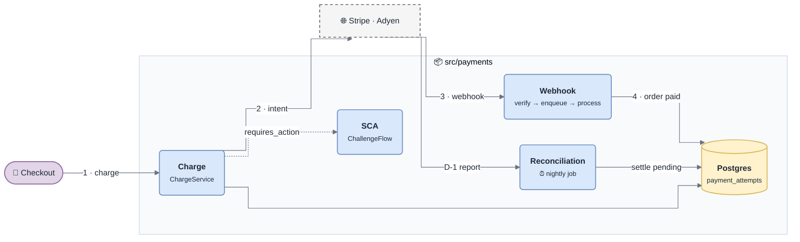
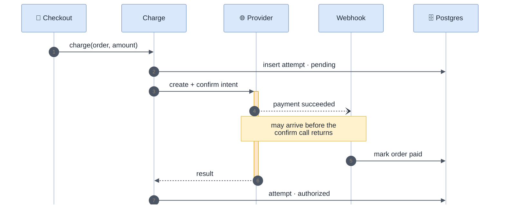
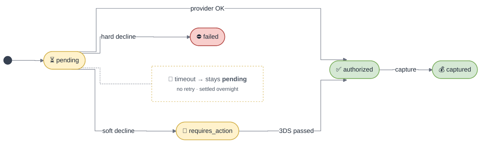

<!-- gotcha:generated · sources: overview.md, modules/charge.md, decisions.md · edit gotchas/ instead, this page is rebuilt -->

# Architecture

## The areas

*Follow the numbers: the charge starts the payment, the webhook finishes it.
Reconciliation is the safety net for everything in between.*

| Area | Responsibility | Read more |
|---|---|---|
| **Charge** | turns "charge order X" into a provider charge; owns the attempt lifecycle | [Charge](modules/charge.md) |
| **SCA** | runs the 3-D Secure challenge when the issuer asks for it | [PSD2 / SCA](standards/psd2-sca.md) |
| **Webhook** | verifies provider events, queues them, and is the **only** writer of "order paid" | [Troubleshooting · Webhooks](troubleshooting/webhooks.md) |
| **Refund** | full and partial refunds, always asynchronous at the provider | [Troubleshooting · Refund](troubleshooting/refund.md) |
| **Reconciliation** | nightly match against each provider's settlement report | [Troubleshooting · Reconciliation](troubleshooting/reconciliation.md) |

## The main flow

*The webhook can overtake the API response. Nothing in the flow may assume the
attempt row is already updated when the webhook lands.*

## The payment lifecycle

*`pending` is not an error state: after a timeout it is the deliberate answer to
"we don't know yet" — see [Decisions](decisions.md#no-automatic-retry-after-an-unknown-outcome).*

## Stack

| Layer | Choice |
|---|---|
| Runtime | Node 22, TypeScript |
| Storage | Postgres — `payment_attempts`, `refunds`, `webhook_events`, `settlement_runs` |
| Queues | `payments.webhooks` (DLQ after 5 attempts), `payments.receipts` (best effort) |
| Providers | Stripe, Adyen |
