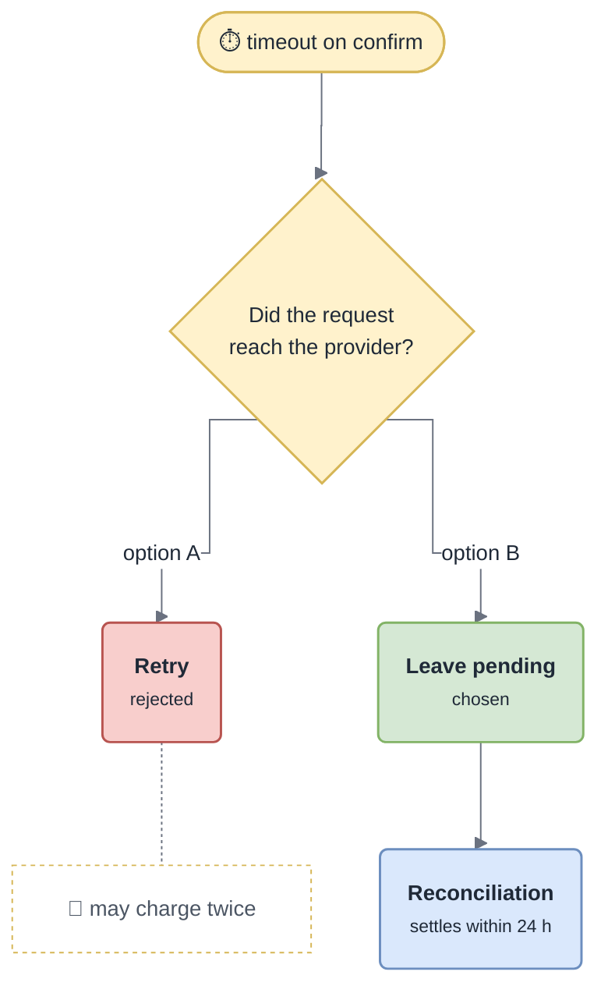

<!-- gotcha:generated · sources: decisions.md · edit gotchas/ instead, this page is rebuilt -->

# Decisions

Some parts of this module look wrong on purpose. Each decision below says what
was chosen, what was rejected, and when it would be worth revisiting. **Read the
relevant one before "fixing" something.**

## No automatic retry after an unknown outcome

*Neither option can answer the question at the moment of the timeout — so the design
waits for one instead of guessing.*

- **Chosen** — leave the attempt `pending`; the nightly reconciliation settles it.
- **Rejected** — retrying with the same idempotency key. It is safe only if the
  first request reached the provider, which is exactly what a timeout leaves unknown.
- **Revisit if** — the 24 h delay becomes the complaint. Then add a status lookup
  at the provider **before** any retry; never a blind retry.

## Receipts and analytics are best effort

- **Chosen** — failures to send the receipt or the analytics event are logged as
  warnings and never fail the payment.
- **Why** — a mail outage must not turn a successful payment into an error; the
  money has already moved.
- **Consequence** — "charged but no receipt" leaves no error anywhere, only the
  warning `receipt dispatch failed`.
- **Revisit if** — receipts become a legal requirement in a market we serve.

## Only the webhook marks an order paid

- **Chosen** — the webhook processor is the single writer of "order paid".
- **Why** — outcomes are asynchronous (3DS, pending payments, refunds); one path
  for every outcome instead of two that could disagree.
- **Rejected** — also marking paid on a synchronous success: two writers, and the
  webhook may arrive first anyway.

## A missing settlement report is not a failure

- **Chosen** — log `report not yet available`, exit successfully, retry 4 h later.
- **Why** — providers publish at different hours; failing paged on-call every
  night for a normal situation, and real failures started being ignored.
- **Revisit if** — a provider stops publishing altogether: alert on unmatched days
  older than 24 h instead.

## Unknown webhook event types are acknowledged

- **Chosen** — log at `info` and answer 2xx.
- **Why** — providers add event types all the time; rejecting them fills their
  retry queues.
- **Revisit if** — a renamed event is missed again: alert on the rate of
  `unhandled webhook event` per type.
