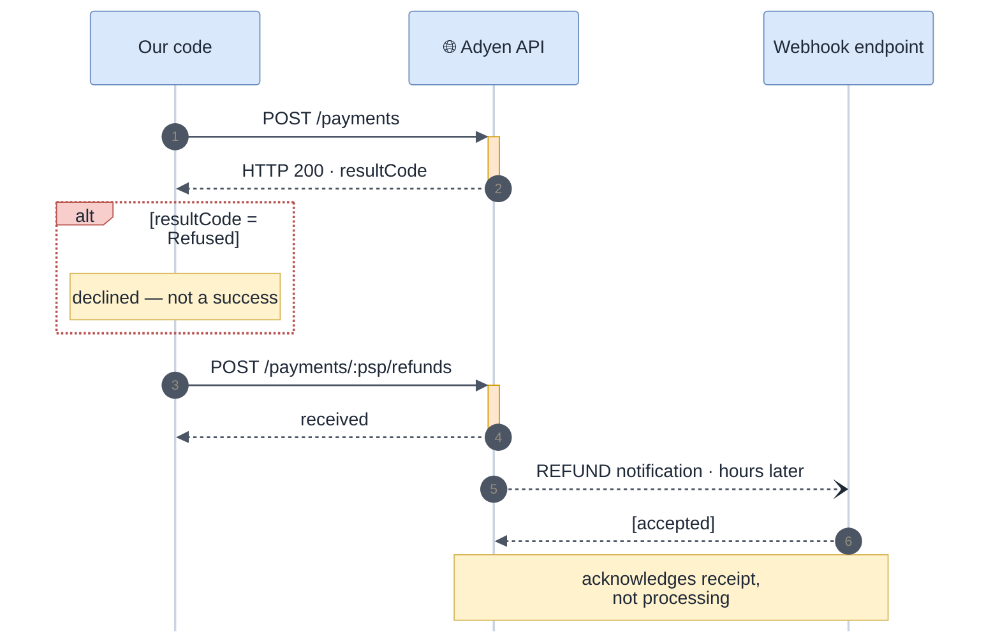

<!-- gotcha:generated · sources: entities/adyen.md · edit gotchas/ instead, this page is rebuilt -->

# Adyen

Adyen looks like Stripe from our side — same client interface — but it signals
failure differently. **An HTTP 200 can be a refused payment**, and **refunds can
fail hours after the API accepted them**.

## How a charge and a refund talk to Adyen

*Read the outcome in `resultCode` (step 2), and the refund result in the
notification (step 5), never in the HTTP status.*

## Watch out for

> [!WARNING]
> **HTTP 200 does not mean success.** The outcome is `resultCode`: `Authorised`,
> `Refused`, `Error`, `Pending`, `RedirectShopper`. Code branching on the status
> code alone treats a refusal as a successful charge.

- **Refunds are always asynchronous.** The API response only says the request was
  recorded; the `REFUND` notification can say `success: false` hours later.
- **Answer `[accepted]` only after the event is safely queued.** Adyen will not
  retry an event it considers delivered.
- **`pspReference` is the only durable id** — and some error responses omit it,
  which can leave a charge impossible to link (see
  [Troubleshooting · Reconciliation](../troubleshooting/reconciliation.md)).
- **Two webhook credentials**: HMAC signature *and* basic auth, the latter set in
  the Adyen dashboard. A webhook 401 is not necessarily our bug.
- **Live URLs are per merchant.** A hardcoded live base URL works in test and
  fails in production.
- **Refund window: 13 months** — but our shared check rejects after 180 days.
  Known gap.

> [!NOTE]
> Not confirmed yet: whether our processor reads every item of a batched
> notification or only the first one; and Adyen's idempotency key retention.

## Configuration

| Variable | Purpose |
|---|---|
| `ADYEN_API_KEY` | API calls (`X-API-Key`) |
| `ADYEN_HMAC_KEY` | webhook signatures |
| `ADYEN_MERCHANT_ACCOUNT` | required on every request, differs per region |
| `ADYEN_ENVIRONMENT` | `test` or `live` |
