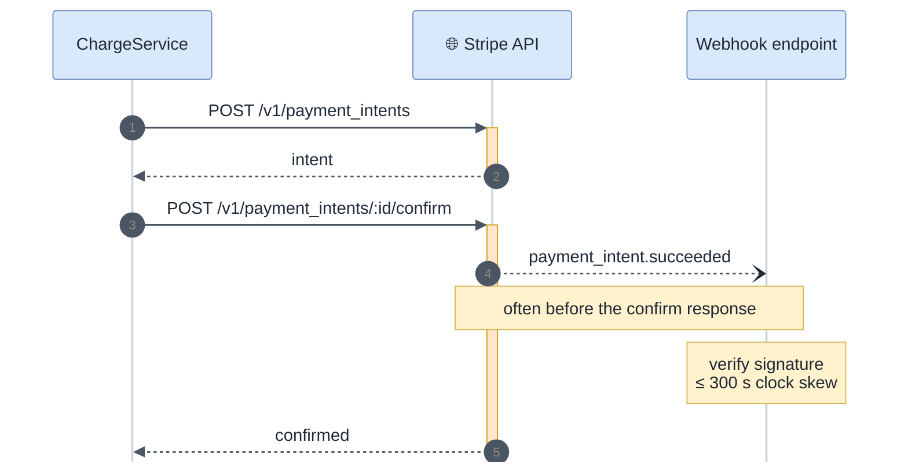

<!-- gotcha:generated · sources: entities/stripe.md · edit gotchas/ instead, this page is rebuilt -->

# Stripe

Stripe is called with a secret key and calls us back with signed webhooks. Two
of its behaviours explain most Stripe incidents: **the webhook can arrive before
our own API call returns**, and **signatures expire after 300 seconds**.

## How a charge talks to Stripe

*The webhook (step 4) routinely beats the confirm response (step 6). Our
processor tolerates an attempt row that does not exist yet.*

## Watch out for

> [!WARNING]
> **Clock skew looks exactly like a wrong secret.** Signature tolerance is 300 s.
> A container clock more than five minutes off fails every webhook with
> `SignatureVerificationError`. Check the skew before rotating anything.

- **Two secrets.** `STRIPE_SECRET_KEY` for API calls, `STRIPE_WEBHOOK_SECRET` for
  webhooks — one per endpoint. Rotating one without the other causes a burst of
  signature errors.
- **Idempotency keys live 24 h.** After that, the same key is a new request.
- **`charge.refunded` fires for partial refunds too**, with nothing saying it is
  partial. Compare amounts with our ledger.
- **The webhook payload version is the one pinned on the endpoint** in the
  Stripe dashboard, not the one our client sends. If the two drift, fields go
  missing silently.
- **Refund window: 180 days**, enforced by Stripe and mirrored by our own check.

## Configuration

| Variable | Purpose |
|---|---|
| `STRIPE_SECRET_KEY` | API calls |
| `STRIPE_WEBHOOK_SECRET` | webhook signatures — per endpoint |
| `STRIPE_API_VERSION` | pinned API version |

See also: [Adyen](adyen.md) — same interface, opposite traps.
