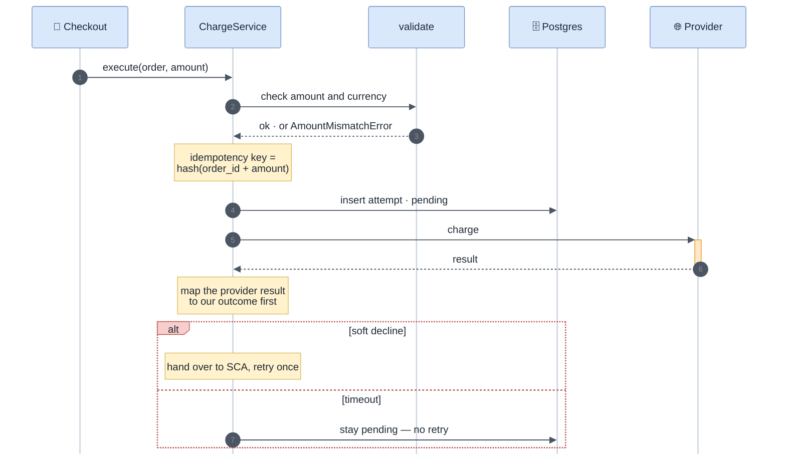

<!-- gotcha:generated · sources: modules/charge.md, decisions.md, troubleshooting/charge.md · edit gotchas/ instead, this page is rebuilt -->

# Charge

`ChargeService.execute` turns "charge order X for amount Y" into a provider
charge, records the attempt, and hands over to SCA when the issuer asks for
authentication. It never marks the order paid itself — the webhook does.

## How a charge flows

*The first two notes on `ChargeService` are the module's invariants: how the
idempotency key is built, and mapping the result before acting on it.*

## What must stay true

> [!WARNING]
> **The idempotency key depends on `order_id + amount` only.** Anything
> time-based or random in it lets a retried request charge the customer twice.

> [!WARNING]
> **A timeout is never a failure.** The attempt stays `pending` and the nightly
> reconciliation settles it. Adding a retry here reintroduces double charges —
> see [the decision](../decisions.md#no-automatic-retry-after-an-unknown-outcome).

> [!IMPORTANT]
> **Map the provider result before branching on it.** Adyen answers HTTP 200 to
> a refused payment; the outcome is in `resultCode`.

## Changing things

| To… | Touch | Watch out for |
|---|---|---|
| add a provider | the provider registry, a client, a result mapper — and an integration page | success may not be in the status code |
| add a currency | `toMinorUnits` and the currency allowlist in `validate` | zero-decimal currencies (JPY, KRW) are charged 100× without the guard |
| change retry behaviour | read [the decision](../decisions.md#no-automatic-retry-after-an-unknown-outcome) first | double charges |

## Related

[Architecture](../architecture.md) · [Troubleshooting · Charge](../troubleshooting/charge.md) ·
[Stripe](../integrations/stripe.md) · [Adyen](../integrations/adyen.md)
