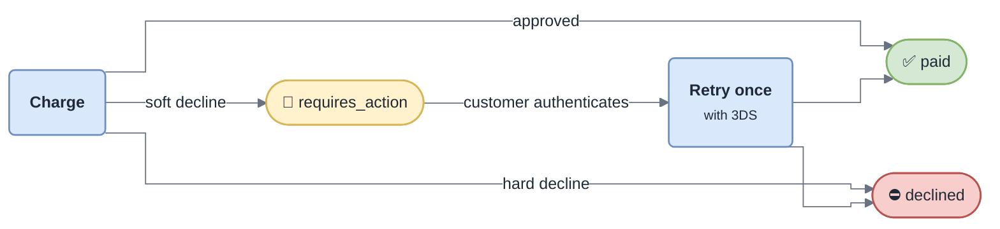

<!-- gotcha:generated · sources: standards/psd2-sca.md · edit gotchas/ instead, this page is rebuilt -->

# PSD2 / Strong Customer Authentication

When both the customer's bank and ours are in the EEA, card payments need two
factor authentication — in practice a **3-D Secure challenge**. For our code
this means a payment has **three** outcomes, not two.

*A soft decline is the issuer saying "ask the customer", not "no". Treating it as
a failure loses the sale and shows up in no error dashboard.*

## Exemptions we claim

| Exemption | When | |
|---|---|---|
| Low value | under €30 | at most 5 in a row or €100 in total per card — **counted by the issuer** |
| Recurring | later charges of a stored mandate | |
| Transaction risk analysis | not claimed | |

> [!NOTE]
> Because the issuer holds the low-value counter, an exemption can be refused at
> any time. A "random" challenge on a small payment is correct behaviour.

## Why it matters beyond compliance

A completed challenge moves fraud liability to the issuer; an exemption keeps it
with us. Every change to the exemptions is a trade between conversion and
chargeback exposure — **a business decision, not a technical one**.

> [!WARNING]
> A challenge takes minutes — the customer switches to their banking app. The
> session must outlive it, or customers come back to an expired session
> ([troubleshooting](../troubleshooting/sca.md)).
