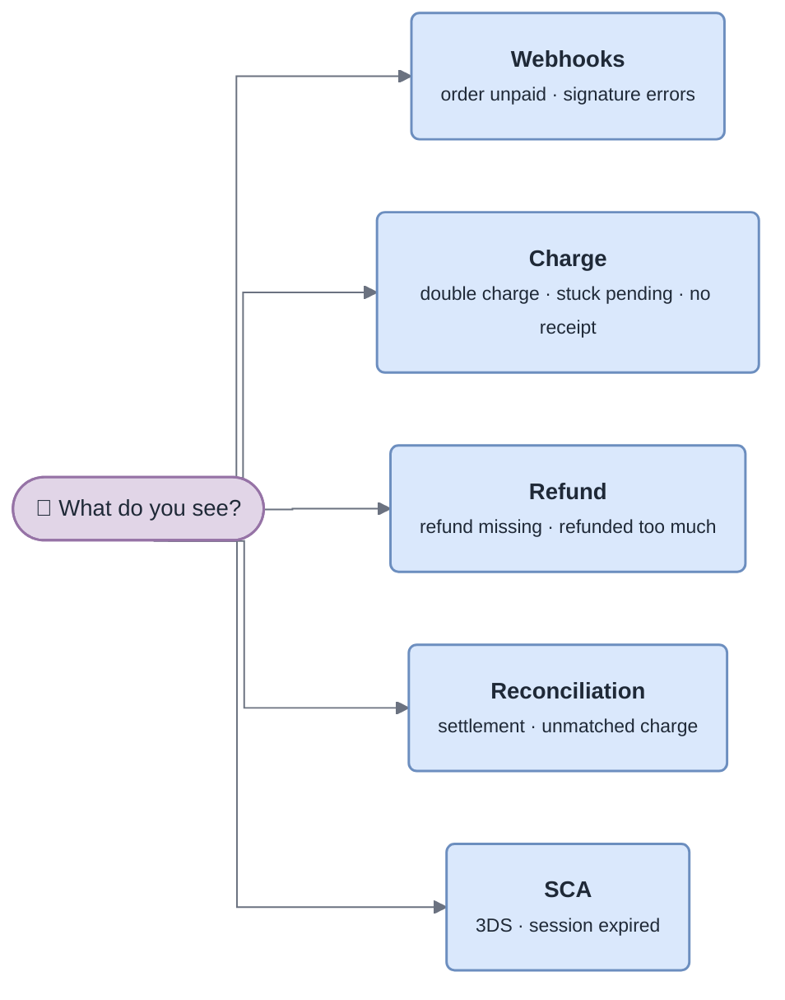

<!-- gotcha:generated · sources: troubleshooting/charge.md, troubleshooting/webhooks.md, troubleshooting/refund.md, troubleshooting/reconciliation.md, troubleshooting/sca.md · edit gotchas/ instead, this page is rebuilt -->

# Troubleshooting

Search this folder for the exact error message or log line first — every known
problem lists the strings it shows up with. Otherwise start from what you see:

| Theme | Typical symptoms |
|---|---|
| [Webhooks](webhooks.md) | `SignatureVerificationError`, order unpaid after a successful charge, duplicate webhook |
| [Charge](charge.md) | double charge, attempt stuck `pending`, `AmountMismatchError` on JPY, no receipt |
| [Refund](refund.md) | refund never received, refunded more than captured |
| [Reconciliation](reconciliation.md) | job green but still pending, provider charge with no local record |
| [SCA](sca.md) | session expired after 3DS, every card challenged |
