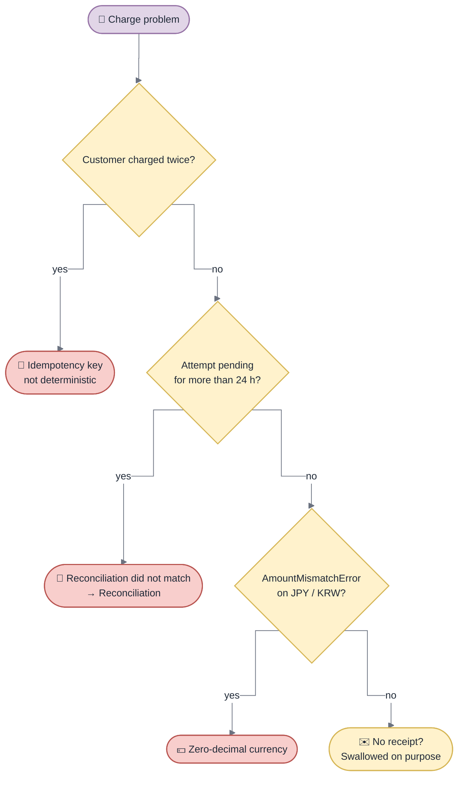

<!-- gotcha:generated · sources: troubleshooting/charge.md · edit gotchas/ instead, this page is rebuilt -->

# Troubleshooting · Charge

## Diagnose

*A charge that "failed" after a timeout is usually not failed: it is `pending`
on purpose and settles overnight.*

## Known problems

### Customer charged twice for one order

- **You see** — two captured charges at the provider for the same order.
- **Check** — two different idempotency keys stored for that order in `payment_attempts`.
- **Fix** — the key must hash `order_id + amount` only — remove anything time-based or random.
- **Repair** — refund the duplicate from the provider dashboard; the ledger follows through the refund webhook.

### Customer charged, no receipt, no error

- **You see** — the payment is fine, the customer never received the email, error logs are clean.
- **Check** — search `receipt dispatch failed` — it is the only trace.
- **Fix** — none on our side; check the mail provider for that time window.
- **Repair** — `payments:receipt:resend --attempt=<id>`.

### Attempt stuck `pending` for more than 24 h

- **You see** — an attempt is still `pending` the next day.
- **Check** — the last settlement runs: a missing `matched_at` means the day did not reconcile.
- **Fix** — see [Reconciliation](reconciliation.md).
- **Repair** — `payments:reconcile --day=YYYY-MM-DD`.

### `AmountMismatchError` on JPY or KRW only

- **You see** — every order in a zero-decimal currency fails validation.
- **Check** — reproduce with `--currency=JPY`: the rejected amount is exactly 100× the order total.
- **Fix** — make `toMinorUnits` currency-aware. **Keep the guard** — it is what prevents a 100× charge.

> [!WARNING]
> Never add a retry after a timeout — see
> [Decisions](../decisions.md#no-automatic-retry-after-an-unknown-outcome).
