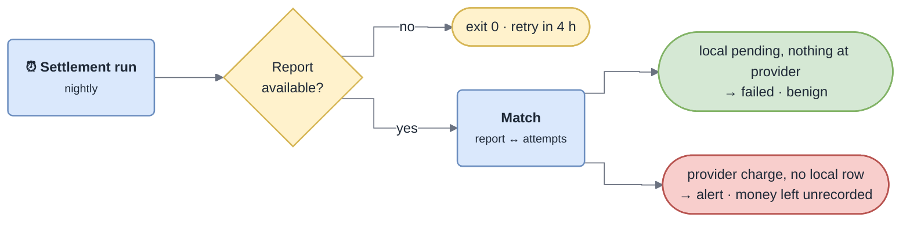

<!-- gotcha:generated · sources: troubleshooting/reconciliation.md · edit gotchas/ instead, this page is rebuilt -->

# Troubleshooting · Reconciliation

Every night, each provider's settlement report for the previous day is matched
against our attempts. This is what settles every payment left `pending`.

*A green run is not a reconciled day: when the report is late the job succeeds
without matching anything.*

## Known problems

### Job green, attempts still pending

- **You see** — the settlement job succeeded but `pending` attempts remain for that day.
- **Check** — the latest `settlement_runs` rows: an empty `matched_at` means the report was not there yet.
- **Fix** — nothing — expected until the 4-hour retry.
- **Repair** — `payments:reconcile --day=YYYY-MM-DD` once the report exists.

### Provider charge with no local record

- **You see** — reconciliation alert: money taken at the provider, no attempt on our side.
- **Check** — find the idempotency key in the provider dashboard, then look it up in `payment_attempts`.
- **Fix** — persist the attempt **before** calling the provider.
- **Repair** — insert the attempt from the provider record, then re-run the day.
