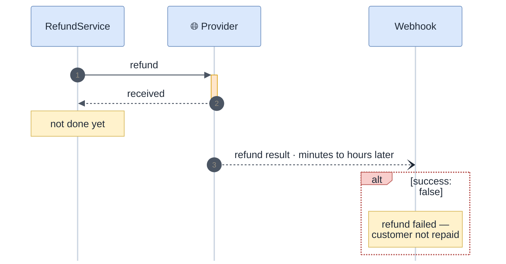

<!-- gotcha:generated · sources: troubleshooting/refund.md · edit gotchas/ instead, this page is rebuilt -->

# Troubleshooting · Refund

Refunds are asynchronous at both providers: the API answer means **recorded**,
not **done**. The real outcome comes later, by webhook.

*Only the notification (step 3) tells whether the customer was repaid.*

## Known problems

### Refund "succeeded", money never returned

- **You see** — the refund shows as done, the customer says nothing arrived.
- **Check** — look for the refund webhook for that payment, not the API response.
- **Fix** — mark refunds done from the webhook only.
- **Repair** — re-issue the refund once the failure reason is known.

### Refunded more than was captured

- **You see** — the refunds add up to more than the captured amount.
- **Check** — two refund rows for the same attempt created less than a second apart.
- **Fix** — serialize refunds per attempt (row lock or queue) — the current guard reads without a lock. **Known gap.**

> [!NOTE]
> Our refund window check uses 180 days for every provider. That is right for
> Stripe and too strict for Adyen (13 months).
