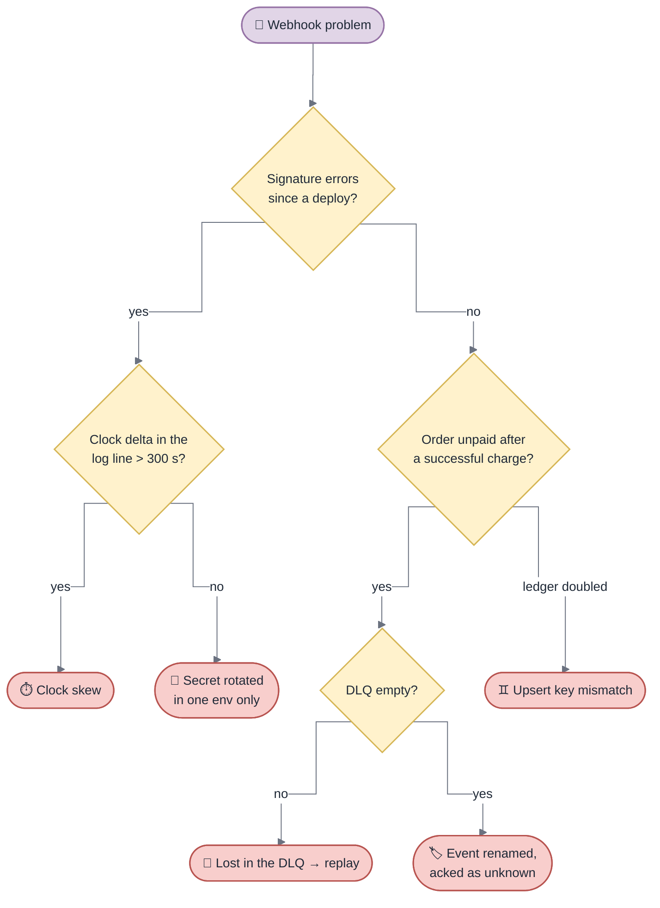

<!-- gotcha:generated · sources: troubleshooting/webhooks.md · edit gotchas/ instead, this page is rebuilt -->

# Troubleshooting · Webhooks

The webhook is what marks an order paid, so **any lost or ignored webhook looks
like a failed payment** to the business.

## Diagnose

*Two questions settle most webhook incidents: is it the signature, and did the
event reach a handler at all?*

## Known problems

### Signature errors right after a deploy

- **You see** — every webhook of one provider fails with `SignatureVerificationError` / `signature verification failed`.
- **Check** — the log line carries the clock delta. Over 300 s ⇒ clock skew. Otherwise compare the deployed secret with the one in the provider dashboard.
- **Fix** — fix the host clock (NTP), or align the secret. **Never rotate the secret before checking the skew.**
- **Repair** — providers retry on their own; replay what reached the dead-letter queue.

### Order unpaid although the charge succeeded

- **You see** — money captured, order still unpaid, usually for one provider only.
- **Check** — the dead-letter queue first; then search `unhandled webhook event` grouped by event type — a type appearing in volume is the answer.
- **Fix** — register a handler for the renamed or new event.
- **Repair** — `payments:webhook:replay --event-id=<id>` for each affected event.

### Webhook processed twice

- **You see** — two ledger entries for one provider event.
- **Check** — look for duplicated `provider_event_id` in `webhook_events`.
- **Fix** — normalize the provider id before the upsert.

> [!NOTE]
> Unknown event types are acknowledged on purpose — see
> [Decisions](../decisions.md#unknown-webhook-event-types-are-acknowledged).
