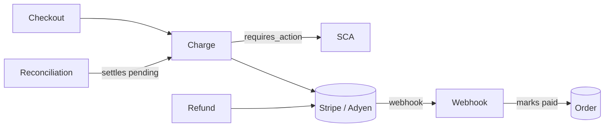

# Payments — overview

> **TL;DR** — charges cards through Stripe and Adyen for the shop's orders.
> Outcomes are asynchronous: the **webhook** marks orders paid (D-003), and a
> nightly reconciliation settles every unknown outcome. `npm run dev` runs it
> against both providers' sandboxes.
>
> verified 2026-09-14 @ 3f9c2ab · scope: src/payments/ · synthetic example

## What it is

The payment module of a monolithic shop backend. It owns charges, refunds, SCA
challenges, provider webhooks and settlement. It does **not** own pricing or
invoicing — it receives an amount and an order id.

## Stack

| Layer | Choice | Where |
|---|---|---|
| Runtime | Node 22, TypeScript | `package.json` |
| Storage | Postgres (`payment_attempts`, `refunds`, `webhook_events`, `settlement_runs`) | `src/db/schema.ts:1` |
| Queues | `payments.webhooks`, `payments.receipts` | `src/queues.ts:12` |
| Providers | Stripe, Adyen | `src/payments/providers/registry.ts:8` |

## Map

| Area | Role | Page |
|---|---|---|
| Charge | intent, confirm, capture; owns the attempt state machine | [modules/charge.md](modules/charge.md) |
| Webhook | verifies, enqueues, processes provider events; marks orders paid | [troubleshooting/webhooks.md](troubleshooting/webhooks.md) |
| Refund | full and partial refunds | [troubleshooting/refund.md](troubleshooting/refund.md) |
| Reconciliation | nightly settlement match | [troubleshooting/reconciliation.md](troubleshooting/reconciliation.md) |
| SCA | 3-D Secure challenge and exemptions | [standards/psd2-sca.md](standards/psd2-sca.md) |

## Run, test, ship

| Task | Command | Notes |
|---|---|---|
| Run locally | `npm run dev` | needs `STRIPE_*` and `ADYEN_*` sandbox keys in `.env` |
| Test | `npm test -- src/payments` | provider calls are recorded fixtures (`test/fixtures/providers/`) |
| Reproduce a charge | `npm run cli -- payments:charge --dry-run` | no money moves |
| Replay a webhook | `npm run cli -- payments:webhook:replay --event-id=<id>` | idempotent |

## Further reading

- `docs/runbooks/nightly-settlement.md` — on-call runbook for reconciliation
