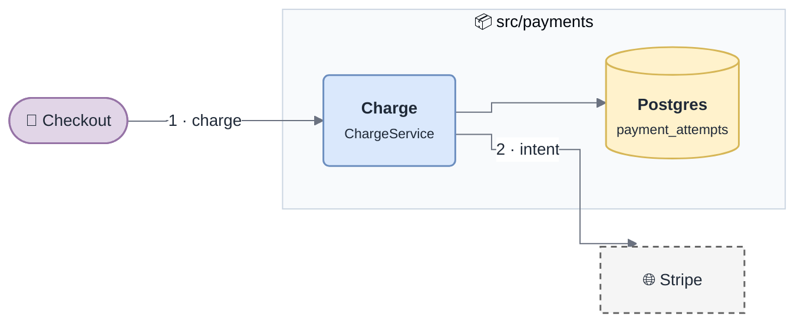
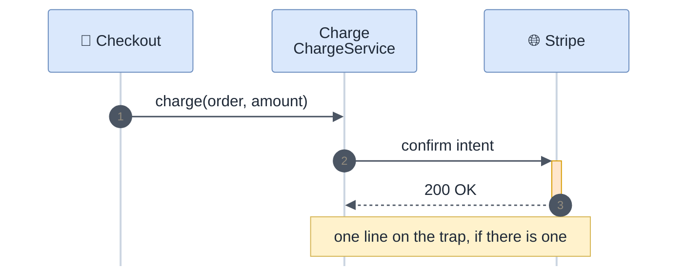

# Diagrams

The house style for every diagram in the human docs. A diagram is worth a
thousand words only when it is **right** and **readable** — a tangled one costs
more than the paragraph it replaced. Everything below was tuned by rendering it,
not by guessing.

Format: **Mermaid**, inside the markdown. It renders natively on GitHub, GitLab
and Notion, diffs line by line in a PR, lays itself out, and can be pasted into
draw.io (*Arrange → Insert → Advanced → Mermaid*) by anyone who wants to retouch
it. The look is draw.io's: its default palette, rounded boxes, orthogonal edges.

## When to draw

Draw whenever the shape of the thing is a graph. Default to drawing:

| Content | Diagram | Where |
|---|---|---|
| The system and its neighbours | context flowchart — the system as one subgraph, actors left, externals dashed | `README.md`, `architecture.md` |
| Areas and how they talk | component flowchart, one node per area | `architecture.md` |
| A flow across ≥ 3 components | sequence diagram, `autonumber` | module and integration pages |
| A lifecycle / state machine | flowchart of stadium nodes, coloured by outcome | module pages |
| An integration with a partner | sequence diagram, partner as a participant | integration pages |
| Troubleshooting a theme | decision tree: symptom → checks (rhombus) → causes → card | troubleshooting pages |
| A decision with alternatives | small flowchart: options side by side, rejected ones in red | decisions, when the trade-off is spatial |
| Run / test / ship | flowchart of steps, only when it branches; a numbered list otherwise | getting-started |

Do **not** draw: a list (use a list), a single arrow, a table in disguise, or
anything the facts do not support. Every node and edge must come from a cited
fact in `gotchas/`. A diagram that invents an arrow is a confident lie.

## Layout rules

Learned from renders that went wrong:

- **≤ 12 nodes per diagram.** More ⇒ split into an overview plus one diagram per
  part. Readability falls off a cliff past that.
- **Labels: 1–4 words** on edges, a bold name + one `<small>` detail line in
  nodes. Sentences go in the caption, not the diagram.
- **Number the main path** (`1 · charge`, `2 · intent`) when order matters and it
  is not a sequence diagram.
- **One labelled edge per node pair.** Two labelled edges converging on the same
  node overlap; label at the source or merge them.
- **No labelled self-loops** — they render broken. Attach a `note` node with a
  dotted link instead.
- **Fan-out of more than 3 edges: no edge labels.** Put the text inside the
  target nodes (`<b>Theme</b><br/><small>symptom · symptom</small>`); long labels
  on parallel edges pile into an unreadable column.
- **Branches leaving a decision carry distinct labels** (`yes` / `no`,
  `option A` / `option B`). Two identical labels read as a bug.
- **A context diagram shows the system as one node.** Its internals belong to
  the architecture diagram; mixing both levels tangles the edges.
- **Use flowcharts for state machines**, not `stateDiagram`: its labels clip and
  its colours cannot be controlled.
- **No self-messages in sequence diagrams** (`S->>S`): they render as clumsy
  loops. Use `Note over S: …` for an internal step.
- **Direction**: `LR` for flows and pipelines, `TB` for hierarchies and decision
  trees.
- **Emojis as icons**, sparingly, one per node at most: 🛒 actor, 🌐 external,
  🗄️ database, 📨 queue, ⏰ scheduled job, 🔐 auth, 💬 note. They stand in for
  draw.io's icon set and survive every renderer.
- **A caption after every diagram**: one italic line saying what to look at.

## Flowchart — copy this block



Keep only the `classDef` lines the diagram uses.

| Meaning | Shape | Class |
|---|---|---|
| person, caller, client | `(["…"])` stadium | `actor` |
| our code: service, module, job | `("…")` rounded | `service` |
| database, cache, bucket | `[("…")]` cylinder | `store` |
| queue, topic, stream | `[["…"]]` | `queue` |
| third party, outside our control | `["…"]` + dashed | `external` |
| state / outcome: good, waiting, bad | `(["…"])` | `ok` · `warn` · `bad` |
| check in a decision tree | `{"…"}` rhombus | `warn` |
| side remark | `["💬 …"]` + dotted link `-.-` | `note` |
| start / end | `(( ))` | `term` |

Group our own code in a `subgraph` named after the directory. Arrows: `-->`
synchronous call or data, `-.->` asynchronous (webhook, event, message),
`-.-` attaches a note.

## Sequence — copy this block



- `->>` call, `-->>` response, `--)` asynchronous message.
- `alt` / `opt` for the failure branch that matters — that is usually the point
  of the diagram. Reference the decision or card id in it (`D-001`).
- ≤ 6 participants, ≤ 12 messages.

## Check before publishing

```sh
sh ${CLAUDE_PLUGIN_ROOT}/scripts/render-diagrams.sh docs/**/*.md
```

Renders every Mermaid block with the official CLI. A diagram that fails to
render is a broken page on every target: fix it before publishing. When you can
view images, open a few renders and look at them — overlapping labels and edges
crossing the whole canvas are bugs too.
