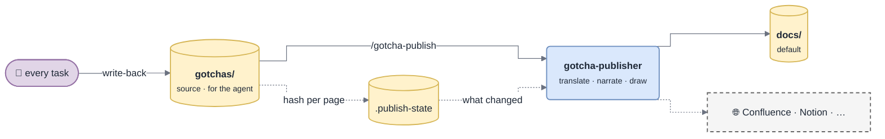

# Publishing

How `gotchas/` (the source, written for the agent) becomes the human docs (a
view, written for people). One source, one-way generation, a freshness check —
so the human docs are always up to date without anyone writing anything twice.



*Only pages whose source changed are rebuilt — publishing costs tokens in
proportion to the change, not to the base.*

## Settings

In `gotchas/manifest.yml`, asked once by `/gotcha-init`:

| Key | Values | Default |
|---|---|---|
| `publish_target` | `docs` · `confluence` · `notion` · `other:<tool>` · `none` | `docs` |
| `publish_language` | any language code — the human docs are written in it | `en` |
| `publish_dir` | output folder for `docs` | `docs` |
| `publish_location` | Confluence space + parent page URL, Notion parent page URL, … | — |
| `publish_when` | `on-change` · `manual` | `on-change` for `docs`, `manual` otherwise |

The source base stays in the manifest's `language:` (English by default: it is
grepped against code and log strings). The human docs are translated at
publication — identifiers, paths, commands and log strings stay verbatim.

## What gets generated

| Output | From | Diagrams |
|---|---|---|
| `README.md` — home | `overview.md`, `INDEX.md` | context diagram; "where to start" by role: new dev, on-call, reviewer |
| `architecture.md` | `overview.md`, `modules/*` | component map, main data flow (sequence), runtime / deployment if known |
| `getting-started.md` | `overview.md` § run, test, ship | flowchart only if setup branches |
| `modules/<area>.md` | `modules/<area>.md`, related `D-NNN` | component diagram, one sequence per key flow, lifecycle if there is a state machine |
| `integrations/<entity>.md` | `entities/<entity>.md` | integration sequence including the failure branch |
| `standards/<name>.md` | `standards/<name>.md` | the protocol's flow as it applies here |
| `decisions.md` | `decisions.md` | options diagram when the trade-off is spatial |
| `troubleshooting/<theme>.md` | `troubleshooting/<theme>.md` | diagnostic decision tree; cards as *If you see → Check → Fix* |
| `glossary.md` | `glossary.md` | — |

Pages for areas with no source page are not generated. A human page is a
**narrative**: it explains in order, for someone reading top to bottom. It
drops what only the agent needs — card ids (kept only where a reader needs to
cross-reference), keywords, `seen` counters, stamps — and adds what a human
needs: transitions, a "why it matters" line, diagrams, callouts.

Use GitHub alerts for callouts — they map to Confluence panels and Notion
callouts:

```markdown
> [!WARNING]
> Never add a retry after a timeout: it can charge the customer twice.
```

Every fact in a human page comes from `gotchas/`. **Publishing never adds
knowledge.** Something missing ⇒ capture it into the source first, then publish.

## Ownership and hand edits

Every generated page starts with:

```markdown
<!-- gotcha:generated · sources: overview.md, modules/charge.md · edit gotchas/ instead, this page is rebuilt -->
```

- The publisher only overwrites or deletes pages carrying this header. Other
  files in the folder are never touched.
- A human edit to a generated page is detected (`publish-check.sh` reports it
  as `edited`). Before rebuilding that page, port the edit into the source,
  then republish. Silently overwriting someone's correction is the fastest way
  to make people stop trusting the docs.

## Freshness

`scripts/publish-check.sh` hashes every source page (ignoring the `<sub>`
metadata lines, so a `seen` bump or a re-stamp does not trigger a rebuild) and
compares with `gotchas/.publish-state`:

```
changed  modules/charge.md      → docs/modules/charge.md docs/architecture.md
new      entities/klarna.md
removed  troubleshooting/sca.md → docs/troubleshooting/sca.md
edited   docs/decisions.md
```

After writing each output: `publish-check.sh --record <output> <remote-id|-> <source,source>`.
`.publish-state` is committed, so the next person and the next session know what
is already published, and which remote page to update.

With `publish_when: on-change` and the `docs` target, the Stop hook asks for a
publish at the end of any turn that changed the source. With `manual`, the
session-start hook mentions how many pages are behind.

## Targets

### `docs` (default)

Markdown files under `publish_dir`, committed with the change and reviewed in
the same PR as the source. Renders on GitHub / GitLab as-is, diagrams included.
Works with MkDocs (`pymdownx.superfences` mermaid) or Docusaurus
(`@docusaurus/theme-mermaid`) if the team wants a site.

### `notion`

Needs a Notion connector / MCP server in the session. One Notion page per output,
under `publish_location`, same hierarchy. Mermaid goes in `mermaid` code blocks,
which Notion renders. Remote page ids go in `.publish-state`.

### `confluence`

Needs an Atlassian / Confluence connector / MCP server. One page per output
under `publish_location`. Confluence does not render Mermaid natively: render
SVGs with `scripts/render-diagrams.sh --out <dir>` and attach them when the tool
can upload attachments; otherwise use a `mermaid` code block if the instance has
a Mermaid macro installed, and say which one was used. GitHub alerts become
info / warning / note panels.

### `other:<tool>`

Any document tool reachable through a connector (Google Docs, Outline, GitBook,
Coda, Claude Docs, …). Same rules: one remote page per output, update in place by
the id stored in `.publish-state`, diagrams as Mermaid if the tool renders it,
else as rendered SVG / PNG.

### Rules for every remote target

- **Publish from the default branch**, after the PR is merged. Publishing from a
  feature branch puts unreviewed facts in front of the whole company. On another
  branch, warn and ask.
- Update pages in place; never delete a remote page without asking.
- No connector available ⇒ say so, explain how to add it, and fall back to `docs`
  for this run.
