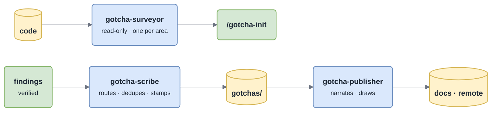

# Agents

Three sub-agents keep bulk reading and writing **out of your main context**. They are a token-budget tool, not a ritual: below their thresholds the skills do the work inline.

*Each agent reads in its own context and returns one line per item.*

| Agent | Tools | Spawned by | When | Returns |
|---|---|---|---|---|
| `gotcha-surveyor` | Read, Grep, Glob, Bash (**read-only**) | `/gotcha-init` | one per area, **in parallel**, when there are more than 3 areas or a large repo | a structured, fully cited findings report (≤ ~250 lines): role, entry points, flows, invariants, where to change X, conventions, decisions, exceptions, swallowed errors, log patterns, repair handles, entities, glossary, unknowns |
| `gotcha-scribe` | Read, Grep, Glob, Edit, Write, Bash | `/gotcha-capture` | ≥ 3 destinations, or target pages not yet in context | one line per write: `+ TS-031 …` · `~ modules/charge.md § Flows (fixed)` · `↑ TS-014 seen 4` · `= skipped (already in D-003)` |
| `gotcha-publisher` | Read, Grep, Glob, Write, Edit, Bash | `/gotcha-publish` | more than 2 outputs, one per group of related outputs, in parallel | one line per page: `+ docs/modules/charge.md (3 diagrams) ← modules/charge.md, decisions.md` (remote pages include id and URL) |

## `gotcha-surveyor` — how it reads

Breadth first, then depth where it pays: list the area → find entry points (routes, consumers, CLI, jobs) → follow the 2–3 most important flows end to end (hot files from `git log` first) → sweep failure semantics (`catch`, `rescue`, `|| true`, `return null`, `TODO`, `HACK`, `deliberately`) → read the throw site of every custom exception. It stops when another file would only confirm what it already knows.

> [!WARNING]
> Never infers behaviour from a name; reads the code at the citation. Never describes what one read of a file makes obvious.

## `gotcha-scribe` — what it will not do

It does **not** investigate: every finding it receives was verified by the caller. It never invents a citation or softens an `_Unknown_` into a claim, and never restructures a page beyond what a cap requires (moving cards, never rewriting them).

## `gotcha-publisher` — the per-page routine

Read the source pages and the cards they reference → plan the page as a reader meets it → **draw first** (diagrams from the [house style](Diagrams)) → write the prose around them in the target language → generated header → write the file or call the connector (update in place by remote id) → `render-diagrams.sh` until it passes.
