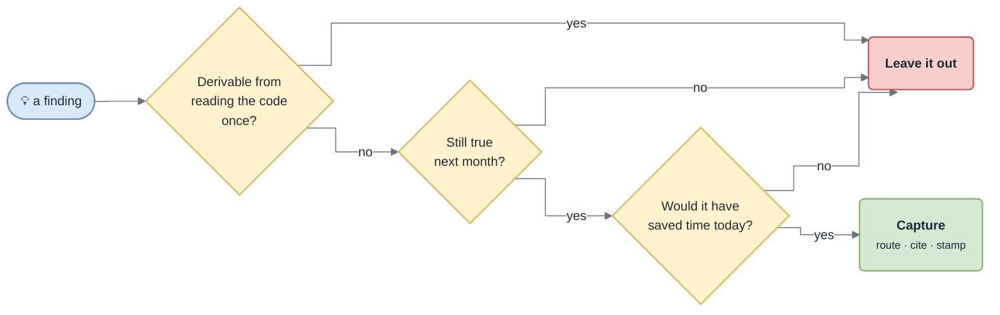

# Capture Contract

The single definition of **what goes into the base and where**. Every write path follows it: `/gotcha-capture`, `/gotcha-investigate` (phase 6), the Stop hook's nudge, the `gotcha-scribe` agent.

## The durability test

A finding is captured only if **all three** hold:

*Anything failing one of the three is left out. A small trusted base beats a large one nobody reads — and the index is paid for in every session.*

A cheaper companion test: **did the docs fail me this turn?** If you had to open several code files to answer something the base should have told you, that is a capture candidate. If the base answered and was right, the only write is a `seen` bump.

## What qualifies

### From any task

- **The answer you had to dig for** — write the map, not the walk: entry point, the hops that matter, the invariant. → module page.
- **A doc that was wrong or stale** — fix in place, cite the code that disproves it, re-stamp. *The highest-trust capture there is.*
- **A convention you had to infer** that a reviewer would reject you for breaking. → `conventions.md`.
- **A domain word** whose code name differs. → `glossary.md`.

### From investigation

- A new **symptom → cause → check** card proven by this incident. The check is the valuable half.
- A failure mode the theme Map did not list; a log pattern or query that located the problem; a repair handle.
- Behaviour confirmed from an online source — captured so no future session needs that search.
- A card that matched ⇒ **bump `seen` and `last`**, sharpen its check. No new card.

### From feature work (stricter)

- **What the external world taught you** — a partner returns 200 on refusal, an id is absent from error responses.
- **A deliberate trade-off**, with the alternatives rejected and why. → `D-NNN`.
- **A swallowed error or dropped path you just introduced.** You are creating a future silent failure while you still understand it. → the theme Map, now. *The highest-value capture in the system, and the one nobody remembers.*
- **A new entity**, at integration time, not after the first incident.
- **Anything that cost more than ~30 minutes** and is not visible in the code.

### Never captured

- What the code now plainly states — the endpoint exists, the class does X
- The ticket narrative, dates, who did what (git holds the story)
- How you built it, step by step
- Preferences of the current user (that is auto memory, not the team's base)
- Anything you did not verify

## Routing

Follow `manifest.yml` `routing:` literally. Default shape:

| Finding | Destination |
|---|---|
| How an area works, where to change X, an invariant | `modules/<area>.md` |
| Project-wide map, commands to run / test / ship | `overview.md` |
| A rule of how code is written here | `conventions.md` |
| A domain term ↔ code name | `glossary.md` |
| A deliberate trade-off | `D-NNN` in `decisions.md` |
| Specific to one entity | `entities/<name>.md` |
| A symptom, failure mode, log pattern, repair handle | `troubleshooting/<theme>.md` |
| Behaviour of an external standard | `standards/<name>.md` |
| A new page of any kind | plus its line in `INDEX.md` (or its hub) |

A finding that fits two destinations goes in **one** — the most specific — with a cross-reference (by card id) from the other. Duplicated facts drift apart and then two pages disagree. No theme fits ⇒ add to the closest one; [`/gotcha-tidy`](Self-Organization) splits later. Never create a theme for a single card.

## Writing rules

- **Cite repo-relative `path/to/file.ext:line`.** No citation, no entry.
- External facts cite their source. Gaps are marked `_Unknown — not confirmed in code_`.
- The **Check** line of a card is never empty.
- **Write the fact, not the story.** One or two sentences; tables where the shape is a table.
- **Stamp what you verified**: `verified <today> @ <git rev-parse --short HEAD>`.
- **Keep the TL;DR true.**
- **Add, do not restructure.** Restructuring is `/gotcha-tidy`'s job.

## After writing

Run `stats.sh`. A page you touched now flagged `SPLIT`, `INDEX>60` or `UNINDEXED` ⇒ apply `/gotcha-tidy` to that page only. A capture that leaves the base over its caps is not finished.

## Modes

See [How It Works → Autocapture modes](How-It-Works#autocapture-modes): `auto` (default), `propose`, `off`.

## The procedure

`/gotcha-capture` runs in six phases:

| # | Phase | |
|---|---|---|
| 1 | **Collect** | this task · `gotcha:` markers (`git grep -n "gotcha:"`) · the diff, for what nobody noted (a new `catch` that logs and continues, an early `return` that drops work, an unexplained constant) |
| 2 | **Filter** | the durability test. Discarding everything is the normal outcome of a small task ⇒ `gotcha: nothing durable` |
| 3 | **Route and dedupe** | `grep -rniF` the key term first. Present and right ⇒ bump. Present and wrong ⇒ fix in place. Absent ⇒ add |
| 4 | **Write** (or propose) | reads only the target section; ids from `stats.sh`; deletes harvested markers. ≥ 3 destinations ⇒ delegated to [`gotcha-scribe`](Agents) |
| 5 | **Organize** | `stats.sh`; tidy flagged pages you touched |
| 6 | **Human docs** | `publish_when: on-change` ⇒ `/gotcha-publish` for the changed pages (`docs` channel) |

> [!WARNING]
> Never fabricate a citation. Never delete a marker without writing its fact or confirming it is already in the base. Never write the base outside the current change set — the PR review is what turns an agent's note into team doctrine.
