# Getting Started

From zero to a project memory and published docs in one command.

## 1. Install

```
/plugin install gotcha --marketplace DamienVauchel/gotcha
```

On the next session in a repository with no base, gotcha offers to build one (once per repository). Or run it yourself:

```
/gotcha-init
```

## 2. Answer one round of questions

| Question | Options | Default |
|---|---|---|
| **Language of the human docs** | any language; the language of your existing docs or commit messages is proposed if it differs | `en` |
| **Where to publish them** *(multiselect)* | `docs/` folder · PDF · Claude artifact · Claude Docs · Google Drive · Notion · Confluence · GitHub wiki · other (Outline, GitBook, Coda…) | `docs/` |
| **The plan** | the areas, scopes and entities found by a first reconnaissance | confirm or adjust |

For every remote channel you tick, init asks its location (space or parent page URL, Drive folder…) and checks that a matching connector exists in the session. A missing connector never blocks the init: that channel is skipped, and `docs/` is still published. See [Publishing Channels](Publishing-Channels).

The **source base in `gotchas/` stays in English** unless you ask otherwise: it is grepped against code and log strings.

## 3. What happens next

```mermaid
%%{init: {"theme":"base","fontFamily":"Inter, Helvetica, Arial, sans-serif","themeVariables":{"fontFamily":"Inter, Helvetica, Arial, sans-serif","fontSize":"14px","lineColor":"#6b7280","primaryColor":"#dae8fc","primaryBorderColor":"#6c8ebf","primaryTextColor":"#1f2937","clusterBkg":"#f8fafc","clusterBorder":"#cbd5e1","edgeLabelBackground":"#ffffff"},"flowchart":{"curve":"step","padding":18,"nodeSpacing":40,"rankSpacing":60,"htmlLabels":true}}}%%
flowchart LR
  classDef service fill:#dae8fc,stroke:#6c8ebf,stroke-width:1.5px,color:#1f2937
  classDef store fill:#fff2cc,stroke:#d6b656,stroke-width:1.5px,color:#1f2937
  classDef ok fill:#d5e8d4,stroke:#82b366,stroke-width:1.5px,color:#1f2937

  p1("<b>0 · Look</b><br/><small>manifest? old base?<br/>existing docs</small>"):::service
  p2("<b>1 · Recon</b><br/><small>tree · manifests<br/>git churn</small>"):::service
  p3("<b>2 · Ask</b><br/><small>language · channels<br/>plan</small>"):::service
  p4("<b>3 · Survey</b><br/><small>one agent per area<br/>in parallel</small>"):::service
  p5[("<b>4 · Write</b><br/><small>gotchas/</small>")]:::store
  p6("<b>5 · Publish</b><br/><small>every channel</small>"):::ok
  p7("<b>6 · Wire up</b><br/><small>CLAUDE.md · stats</small>"):::ok

  p1 --> p2 --> p3 --> p4 --> p5 --> p6 --> p7
```



*Small repository (3 areas or fewer) ⇒ the survey runs inline; the agents are a token-budget tool, not a ritual.*

| Phase | What it does |
|---|---|
| 0 | `manifest.yml` exists ⇒ re-run: **refresh** (fill gaps, never overwrite a human-written fact) or stop. `failure-modes.md` exists ⇒ migrate a 0.1 base. Existing `README`, `docs/`, ADRs are **inputs**: linked, not copied |
| 1 | ~10 cheap tool calls: tree, build manifests, README, `git log` churn. Derives **areas** (3–12), **scopes**, **entities** |
| 2 | The questions above — the only ones of the whole init |
| 3 | One `gotcha-surveyor` per area; you meanwhile survey conventions, run/test/build commands (each verified), glossary |
| 4 | Writes the base. Troubleshooting **Maps** are pre-filled from code (exceptions, swallowed errors, log patterns, repair handles); **Cards** stay empty — they come from real incidents |
| 5 | `/gotcha-publish --all`, then checks the main diagrams render and read well |
| 6 | Two lines in `CLAUDE.md`/`AGENTS.md`, `stats.sh` flags fixed, a report with the `_Unknown_` count |

> [!NOTE]
> A large monorepo gets **one base per bounded context** (`apps/billing/gotchas/`), not one global base. Init asks which one if it is ambiguous.

## 4. Commit it

Everything init wrote is in the working tree. Review it like any change: each fact is cited, each gap marked. From then on both layers grow by themselves — see [How It Works](How-It-Works).

## Without the plugin loop

You can use the scripts and the page format by hand: see [Scripts](Scripts).
