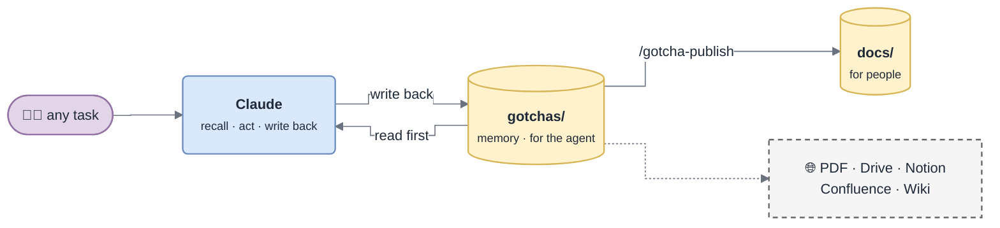

# gotcha

**The project memory your codebase earned** — written by the agent, reviewed in PR, published as docs people actually read.

gotcha is a [Claude Code](https://claude.com/claude-code) plugin. It gives a repository a memory that maintains itself: the agent reads it before every task, writes back what the task taught, and the human docs follow.

*Two layers, one source of truth: the memory is written for the agent, the docs are generated for people.*

## Start here

| I want to… | Read |
|---|---|
| install it and run it once | [Getting Started](Getting-Started) |
| understand the loop and the hooks | [How It Works](How-It-Works) |
| know what files get written | [Memory Layout](Memory-Layout) |
| see what a page and a card look like | [Page Format](Page-Format) |
| know what is worth writing down | [Capture Contract](Capture-Contract) |
| publish to Notion, Confluence, Drive, a PDF… | [Publishing](Publishing) and [Publishing Channels](Publishing-Channels) |
| change a setting | [Configuration](Configuration) |
| use a command | [Commands](Commands) |
| keep the base small and true | [Self-Organization](Self-Organization) and [Linting](Linting) |
| draw diagrams in the house style | [Diagrams](Diagrams) |
| run the helper scripts | [Scripts](Scripts) |
| answer "why not just…?" | [FAQ](FAQ) |
| upgrade | [Upgrading](Upgrading) |
| contribute | [Contributing](Contributing) |

## The ideas in one minute

- **Plain markdown in git.** No server, no embeddings. Reviewed in a PR like any change.
- **Cheap to read.** Index → TL;DR → one card. The code is the last resort.
- **Cited and pinned.** Every fact carries `path/to/file.ext:line`, and every page a `verified <date> @ <sha>` stamp, so rot is measurable.
- **Self-feeding.** A Stop hook asks every turn that learned something what it learned.
- **Self-organizing.** Themes split, merge and archive around the problems people actually hit.
- **Published, not duplicated.** Human docs are generated from the memory, on every channel you pick.

See the [payments-gateway example](https://github.com/DamienVauchel/gotcha/tree/main/examples/payments-gateway) for both layers filled in.
