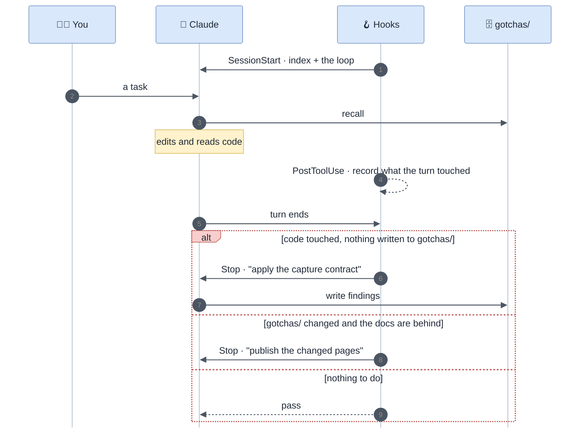

# How It Works

Every task runs the same three-step loop. Three hooks make it automatic.

## The loop

1. **Recall** — pick pages from the index. An error or symptom ⇒ `grep` it in `gotchas/troubleshooting/` first and read only the matching card. Read a page's TL;DR before its body. Details: [Recall and Investigation](Recall-and-Investigation).
2. **Act** — do the task. Go to the code when the docs are silent, stale, or about to be relied on.
3. **Write back** — what the task taught that the docs lacked goes into `gotchas/`, in the same change set. Nothing durable ⇒ write nothing. Details: [Capture Contract](Capture-Contract).

Then the human docs follow ([Publishing](Publishing)) and the base reorganizes itself when a page outgrows its caps ([Self-Organization](Self-Organization)).

## The hooks



*The Stop gate nudges at most once per turn.*

| Hook | When | Does |
|---|---|---|
| `SessionStart` | startup, resume, clear, compact | injects the index (hard-capped at 80 lines) and the loop. No base ⇒ offers `/gotcha-init`, once per repository. Mentions how many source pages are behind the human docs |
| `PostToolUse` | `Read`, `Edit`, `Write`, `MultiEdit`, `NotebookEdit` | silently records which **code** files and which **base** files the turn read or edited. Never blocks |
| `Stop` | end of a turn | see below |

### The Stop gate

| Situation | Result |
|---|---|
| the turn wrote to `gotchas/` and `publish_when: on-change` and `docs` is a channel and pages are behind | asks for an incremental publish of the changed pages |
| the turn wrote to `gotchas/` otherwise | passes |
| `autocapture: off` | passes |
| the turn edited ≥ `nudge_min_edits` code files **or** read ≥ `nudge_min_reads` distinct ones, and wrote nothing to `gotchas/` | sends Claude back **once** to apply the capture contract. Nothing durable ⇒ the reply is exactly `gotcha: nothing durable` |
| anything else | passes |

Without the gate, write-back is a good intention. With it, every turn that learned something is asked what it learned — and a turn that learned nothing costs one line.

## The `gotcha:` marker

Mid-task you do not want to stop and edit a doc, and at the end you have forgotten half of what you learned. Drop a one-line comment where you learn it:

```ts
// gotcha: Adyen signals refusal in resultCode, HTTP is 200 either way
```

`/gotcha-capture` harvests markers, routes each one, and **deletes the marker** once the fact is in the base. Markers piling up mean the loop is not running: `stats.sh` counts them and [`/gotcha-lint`](Linting) lists them. Never commit a marker as permanent documentation.

## Autocapture modes

Set `autocapture:` in [`manifest.yml`](Configuration).

| Value | Behaviour |
|---|---|
| `auto` *(default)* | write directly, report the pages touched in one line. **The PR is the review** |
| `propose` | list the findings with their destination, write after confirmation |
| `off` | no Stop-hook nudge; capture only on explicit `/gotcha-capture` |

In every mode the writes land in the **working tree**, next to the code change, so a human reviews each fact in the PR before it becomes doctrine.

## Why it stays cheap

| Tier | What | Cost |
|---|---|---|
| **L0** | `INDEX.md` — one hook line per page | always in context, ≤ 60 lines |
| **L1** | a hub page, or a page's TL;DR | ~10 lines |
| **L2** | one section, or one card | ~15 lines |
| **L3** | the code | only when in doubt |

The cost of a question is one index line, one hub line, one card — whatever the size of the base. Surveying and bulk write-backs run in [agents](Agents), in their own context.
