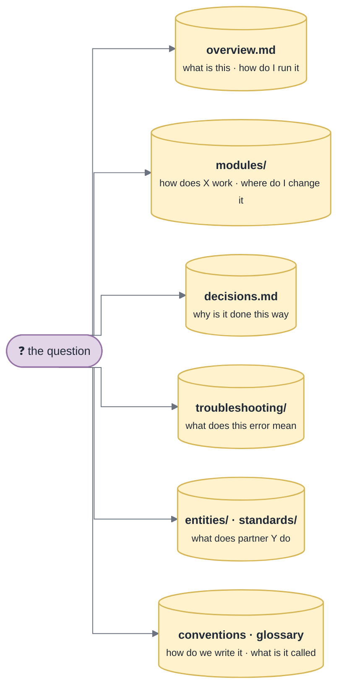

# Memory Layout

What `/gotcha-init` writes, and what each file is for. This is the **source** layer, written for the agent. The human docs are generated from it ([Publishing](Publishing)).

```
gotchas/
  INDEX.md                 L0 router — one hook line per page, injected every session (≤ 60 lines)
  manifest.yml             the only repo-specific config: areas, scopes, routing, evidence, mode
  overview.md              what this is, the map, how to run / test / ship
  conventions.md           rules a reviewer rejects you for that no linter enforces
  glossary.md              what people say → what the code calls it
  decisions.md             deliberate trade-offs, D-NNN cards
  modules/<area>.md        how an area works: flows across files, invariants, where to change X
  entities/<name>.md       one partner / provider / tenant / plugin each, quirks first
  standards/<name>.md      the part of an external spec that actually bites here
  troubleshooting/
    INDEX.md               L1 theme router: literal error strings, card count, last seen
    <theme>.md             failure Map + TS-NNN symptom cards
    _archive.md            cold cards — not indexed, still greppable
  _template.md             entity skeleton for the next one
  .publish-state           what the human docs were built from (committed)
```

> [!IMPORTANT]
> Only `INDEX.md`, `manifest.yml`, `overview.md` and `troubleshooting/INDEX.md` are mandatory. Every other page exists **only when it has content** — an empty page is noise in the index that every session pays for.

## Which page answers which question



## Page kinds

| Page | Holds | Notes |
|---|---|---|
| `overview.md` | purpose, stack, map of areas (mermaid if it helps), commands to run / test / ship | every command verified to exist |
| `modules/<area>.md` | role, entry points, flows across files, invariants, "to add a X, touch A, B, C" | not a list of classes — a worse `ls` |
| `conventions.md` | only rules **not enforced by a linter** and **not obvious** | |
| `glossary.md` | domain terms whose code name differs | |
| `decisions.md` | `D-NNN` cards: decision, why, **rejected**, revisit-if, where | the code keeps the decision and destroys the reason |
| `entities/<name>.md` | one per recurring per-instance thing; quirks first | only when the repo has such an axis (an enum, a registry, sibling adapters) |
| `standards/<name>.md` | the part of an external spec that actually bites here | |
| `troubleshooting/<theme>.md` | a failure **Map** from the code, then **Cards** from real incidents | see [Page Format](Page-Format) |

## The Map vs. the Cards

Every troubleshooting theme has two parts, in this order:

1. **Map** — reference tables derived from the code, filled by `/gotcha-init`: exceptions and their throw conditions, **swallowed errors and dropped work**, log patterns, repair handles. Answers *"what can fail here"*.
2. **Cards** — `TS-NNN`, real incidents only, hottest first. Answers *"this happened, what is it"*.

> [!WARNING]
> Init leaves the **Cards** empty on purpose. An invented card poisons the base with a confident guess.

## Index lines are hooks, not summaries

They say **when to open** the page:

- ✗ `- [Stripe](entities/stripe.md) — Stripe integration`
- ✓ `- [Stripe](entities/stripe.md) — webhook can beat our own API response; signature tolerance 300 s`

## Monorepos

One base per bounded context (`apps/billing/gotchas/`), chosen at init. The scripts take the base directory as an argument (`stats.sh apps/billing/gotchas`) or via `GOTCHA_BASE_DIR` (`publish-check.sh`).

> [!NOTE]
> The hooks currently look for `gotchas/` at the project root only.
