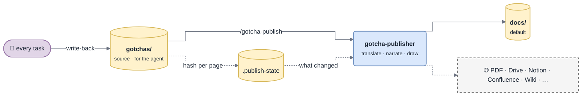

# Publishing

How `gotchas/` (the source, for the agent) becomes the human docs (a view, for people). One source, one-way generation, a freshness check — so the human docs are always up to date without anyone writing anything twice.



*Only pages whose source changed are rebuilt — publishing costs tokens in proportion to the change, not to the base.*

> [!IMPORTANT]
> **Publishing never adds knowledge.** Every fact in a human page comes from `gotchas/`. Something missing ⇒ capture it into the source first, then publish.

## What gets generated

| Output | From | Diagrams |
|---|---|---|
| `README.md` — home | `overview.md`, `INDEX.md` | context diagram; "where to start" by role: new dev, on-call, reviewer |
| `architecture.md` | `overview.md`, `modules/*` | component map, main data flow (sequence), runtime / deployment if known |
| `getting-started.md` | `overview.md` § run, test, ship | flowchart only if setup branches |
| `modules/<area>.md` | `modules/<area>.md`, related `D-NNN` | component diagram, one sequence per key flow, lifecycle for a state machine |
| `integrations/<entity>.md` | `entities/<entity>.md` | integration sequence including the failure branch |
| `standards/<name>.md` | `standards/<name>.md` | the protocol's flow as it applies here |
| `decisions.md` | `decisions.md` | options diagram when the trade-off is spatial |
| `troubleshooting/<theme>.md` | `troubleshooting/<theme>.md` | diagnostic decision tree; cards as *If you see → Check → Fix* |
| `glossary.md` | `glossary.md` | — |

Pages for areas with no source page are not generated. A human page is a **narrative**: it explains in order — what it is → why it matters → how it works → what to watch out for → where to go next. It drops what only the agent needs (keywords, `seen` counters, stamps) and adds what a human needs: transitions, a "why it matters" line, diagrams, callouts.

Callouts use GitHub alerts, which map to Confluence panels and Notion callouts:

```markdown
> [!WARNING]
> Never add a retry after a timeout: it can charge the customer twice.
```

## Ownership and hand edits

Every generated page starts with:

```markdown
<!-- gotcha:generated · sources: overview.md, modules/charge.md · edit gotchas/ instead, this page is rebuilt -->
```

- The publisher only overwrites or deletes pages carrying this header. Other files in the folder are never touched.
- A human edit to a generated page is detected (`publish-check.sh` reports it as `edited`). Before rebuilding that page, the correction is **ported into the source**, then republished. Silently overwriting someone's correction is the fastest way to make people stop trusting the docs.

## Freshness

`scripts/publish-check.sh` hashes every source page — ignoring the `<sub>` metadata lines, so a `seen` bump or a re-stamp does not trigger a rebuild — and compares with `gotchas/.publish-state`:

```
changed  modules/charge.md      → docs/modules/charge.md docs/architecture.md
new      entities/klarna.md
removed  troubleshooting/sca.md → docs/troubleshooting/sca.md
edited   docs/decisions.md
```

After writing each output: `publish-check.sh --record <output> <remote-id|-> <source,source>`. `.publish-state` is **committed**, so the next person and the next session know what is already published and which remote page to update. Each channel has its own rows, so adding a channel later publishes everything to it without touching the others.

## When it runs

| Setting | Behaviour |
|---|---|
| `publish_when: on-change` + `docs` in `publish_targets` | the Stop hook asks for a publish of the **`docs` channel** at the end of any turn that changed the source |
| `publish_when: manual` | the session-start hook mentions how many pages are behind; run `/gotcha-publish` yourself |
| remote channels | **always manual**, and from the default branch, after merge |

## The `/gotcha-publish` procedure

1. **What changed** — `publish-check.sh`. `fresh` ⇒ stop. `edited` ⇒ port the correction into `gotchas/` first. A channel with no rows in `.publish-state` ⇒ everything, for that channel.
2. **Check each channel** — connector available? branch is the default one? Otherwise warn / skip, and make sure `docs` was published.
3. **Generate** — ≤ 2 outputs inline; more ⇒ parallel [`gotcha-publisher`](Agents) agents, one per group of related outputs.
4. **Verify** — `render-diagrams.sh` on every page written; links between generated pages resolve; pages for removed sources are deleted (local) or reported (remote — never deleted without asking).
5. **Record** — `publish-check.sh --record …` per output and channel; a final `publish-check.sh` must print `fresh`.

Writing rules for every page: every fact from the source · draw by default wherever the content is a flow, lifecycle, map, integration or diagnosis ([Diagrams](Diagrams)) · narrate · translate prose and diagram labels to `publish_language` (identifiers, paths, commands, log strings and error messages stay verbatim) · the generated header.

Channels in detail: [Publishing Channels](Publishing-Channels).
