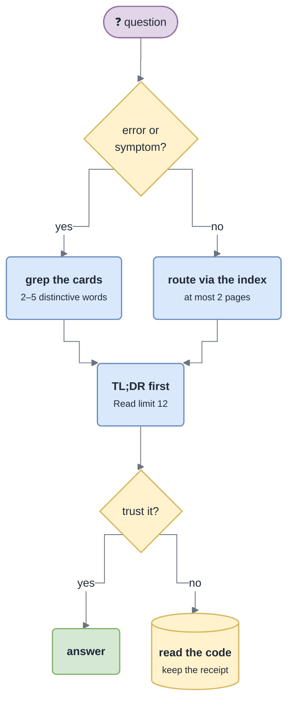

# Recall and Investigation

## Recall — look it up at the lowest cost

A base is worth something only if consulting it is cheaper than re-reading the code. `/gotcha-recall` (normally automatic) is that procedure.

1. **Route.** From the question, pick at most **two** pages in the index; the hook lines say when to open each.
2. **Grep the cards.** `grep -rniF -e "<fragment>" gotchas/troubleshooting gotchas/decisions.md`. Use the 2–5 most distinctive words, never the whole message (ids, timestamps and values never match). One hit ⇒ read **only that card** (`offset` at the hit, `limit: 15`). No hit ⇒ the theme row in `troubleshooting/INDEX.md`, then the theme Map. Also try `_archive.md`.
3. **TL;DR before body.** Read the first 12 lines; often that is the answer. Never read a whole page "for context".
4. **Decide whether to trust it** — read the code anyway when:
   - the docs are **silent**;
   - you are about to **change code** on the strength of a cited fact (spot-check the cited line);
   - the page may be **stale** — `stale.sh <page>` lists cited files changed since the fact was verified;
   - two pages disagree, or a page contradicts the code (**the code wins**; fix the doc in the write-back);
   - the fact is `_Unknown — not confirmed in code_`.
5. **Keep the receipt.** When you do read the code, note what the docs *lacked*, what they got *wrong*, and which card *answered* — the Stop hook's write-back will ask for exactly that.

> [!TIP]
> **Budget:** a recall that reads more than three base pages or ~150 lines of them has gone wrong — either the index hooks are bad (fix them in the write-back) or the question belongs to the code.

## Investigate — diagnosis first, fix second

`/gotcha-investigate <symptom | error | entity | ticket>` handles a bug against the cards first. It never applies a fix before the root cause is established **and** you asked for one.

| Phase | What happens |
|---|---|
| **1 · Recall** | grep the cards. **A card matches** ⇒ run its **Check**; confirmed ⇒ go to the report with the card's Fix and Repair. No card ⇒ classify into a theme, read its Map, then the entity page. Check `decisions.md`: a large share of reported "bugs" are **documented deliberate behaviour** — saying so and stopping is a successful outcome |
| **2 · Evidence** | the exact error verbatim → the throw site; logs (built from `evidence.logs` — no access ⇒ give the exact query, never guess its result); the state the failing path reads (rows, cursors, DLQs); a reproduction (`evidence.repro`). State plainly which evidence you could not get |
| **3 · Trace** | entry → application → domain → external adapter. At each hop: what is validated, caught and swallowed, retried, logged. The gap between *what is logged* and *what happened* is where the root cause hides |
| **4 · Refute** | state the root cause with its evidence chain; **try to refute it** — rule out config vs. code vs. data vs. remote vs. infrastructure |
| **5 · Report** | Symptom → Evidence → Root cause → Blast radius → Proposed fix *(not applied)* → Repair path for existing bad state |
| **6 · Write back** | **mandatory**: a card matched ⇒ bump `seen`/`last`, sharpen its Check; no card ⇒ new `TS-NNN` with the pasted strings as keywords; new failure mode / log pattern / repair handle ⇒ the Map; doc wrong ⇒ fix in place; learned online ⇒ capture with its source |

> [!NOTE]
> The repair path is often the urgent half: the code fix stops new damage, the repair handle fixes the rows already corrupted.

**Local knowledge first**: no web search, partner docs or specs before exhausting phase 1. If an online lookup turns out to be necessary, its result **must** land in the base in phase 6 — that write-back is what makes the second occurrence of a bug cheap.
