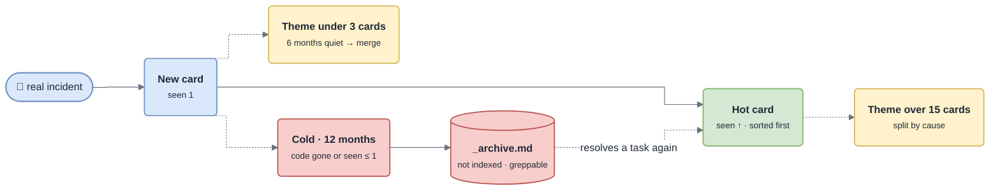

# Self-Organization

The base organizes itself around the problems people actually hit, not around the code layout. `scripts/stats.sh` measures every page **without reading it**; `/gotcha-tidy` acts on the flags. It changes **structure only — never the facts**.

## The life of a card



## Thresholds

| Rule | Threshold | Action | `stats.sh` flag |
|---|---|---|---|
| L0 index too long | `INDEX.md` > 60 lines | collapse a section into a hub page | `INDEX>60` |
| Page too long | > 300 lines | split by section into sibling pages | `SPLIT(lines)` |
| Theme too large | > 15 cards | split into 2–4 sub-themes | `SPLIT(cards)` |
| Theme too small | < 3 cards and nothing seen for 6 months | merge into the closest theme | `MERGE?` |
| Cold cards | `last` older than 12 months | move to `_archive.md` | `COLD` |
| Missing TL;DR | no `> **TL;DR**` block | write it | `NO_TLDR` |
| Orphan page | not linked from any index | link it, or merge it | `UNINDEXED` |

Override with environment variables — `GOTCHA_INDEX_MAX`, `GOTCHA_PAGE_MAX`, `GOTCHA_CARDS_MAX`, `GOTCHA_CARDS_MIN`, `GOTCHA_COLD_DAYS` — **globally, not per page.**

## Splitting a theme

1. Cluster the cards by **cause**, not by symptom wording: cards citing the same mechanism belong together.
2. Two to four clusters. A cluster of one stays with its nearest neighbour.
3. Name each new theme after what the reader is facing, kebab-case, prefixed by the parent: `webhooks-signature.md`, `webhooks-delivery.md`.
4. Split the **Map** too: each exception / log pattern goes with the cards that cite it. Shared entries go to the most specific theme with a one-line pointer elsewhere.
5. Cards keep their ids. Delete the parent page. Update `troubleshooting/INDEX.md` (and `INDEX.md` if it listed the parent).

`/gotcha-init` seeds one theme per scope; real incidents decide the rest.

## Merging, archiving, ordering, hubs

- **Merge** — the inverse: append cards and Map rows to the target, union the keywords in the hub line, delete the source. Ask first if the closest theme is not obvious.
- **Archive** — never delete. A card is archived when it is cold **and** at least one of: its cited code is gone (`stale.sh` says `missing`), or it was seen at most once. A cold card whose code still exists and which was seen often **stays**: a rare but real failure is exactly what the base is for. It moves back, `seen` bumped, the day it resolves a task.
- **Ordering** — inside a theme, cards are sorted by `seen` descending so the first card read is the likeliest answer. Only `/gotcha-tidy` re-sorts; capture appends, so ordinary diffs stay small.
- **Hubs** — when an `INDEX.md` section passes ~10 lines, replace it with one line pointing to a hub page holding the full list (`modules/INDEX.md`, `entities/INDEX.md`). Never nest hubs more than one level: L0 → hub → page.

## Running it

```sh
sh scripts/stats.sh gotchas
```

```
page                                          lines cards  cold verified    flags
overview.md                                      64     -     -  2026-09-14
troubleshooting/webhooks.md                     212    16     2  2026-09-14  SPLIT(cards) COLD

next ids: TS-031 D-004 · unharvested gotcha: markers: 0
```

`/gotcha-tidy [page]` works only the flagged pages (no flag ⇒ it says so and stops). It is triggered by `stats.sh` flags, by a capture that pushed a page over its caps, or by you.
